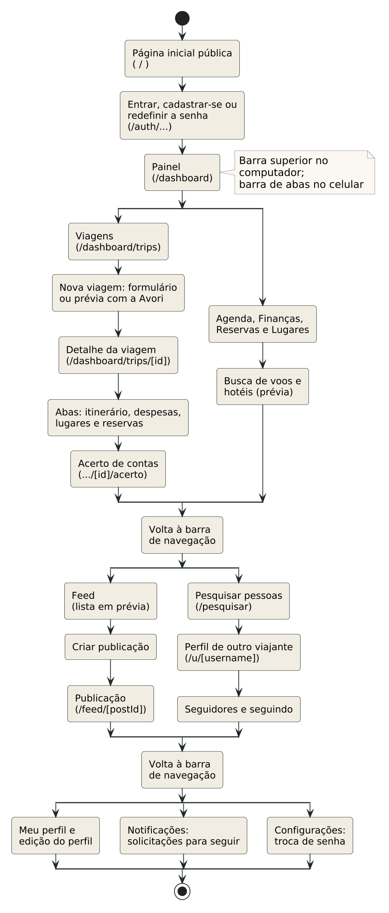

## 16 Design da Solução e Experiência do Usuário

### 16.1 Fluxo de Navegação

A Figura 16.1 mostra o caminho principal do usuário, da página inicial pública até as áreas do sistema. Desde 13/11/2026 as telas usam a identidade visual Avori, que é o nome do produto na interface; o projeto continua se chamando Viaja Mais. A navegação foi refeita junto com a identidade.

No computador, uma barra superior reúne as seções em pílulas, a pesquisa, o sino de notificações, o botão Nova viagem e o menu da conta. No celular, a barra superior mostra só a marca, o sino e o avatar, e uma barra de abas fixa no rodapé oferece Início, Pesquisar, Nova viagem, Viagens e Perfil. As seções que não cabem nas abas ficam no menu do avatar.

O visitante entra pela página inicial e só alcança as telas de autenticação: entrar, cadastrar-se e redefinir a senha. Qualquer outra rota exige sessão; sem ela, o painel devolve o usuário à tela de entrada. Autenticado, ele chega ao painel, de onde parte a barra de navegação.

A figura está dividida em três blocos, ligados pelo retorno à barra de navegação. O usuário não percorre as áreas em sequência: termina o que foi fazer em uma e escolhe outra pela barra. Dentro de cada coluna, a seta indica a tela alcançável a partir da anterior. Escolhemos essa forma vertical, e não um mapa com todas as telas lado a lado, para que a figura caiba na página sem reduzir o texto.

O primeiro bloco reúne as viagens, objeto central do sistema. Nova viagem oferece dois caminhos: o formulário, que grava a viagem, e Montar com a Avori, que abre uma prévia de roteiro por IA com dados de exemplo e não grava nada. O detalhe da viagem traz as abas de itinerário, despesas, lugares e reservas, a lista de participantes, o botão Editar, visível só ao dono, e o botão Publicar viagem. Da aba de despesas parte o acerto de contas.

Ao lado das viagens ficam as visões gerais, que juntam os dados de todas as viagens do usuário: Agenda, Finanças, Reservas e Lugares. Elas existem porque o usuário nem sempre entra pensando em uma viagem: às vezes quer saber quanto já gastou ou o que tem marcado para amanhã. A partir de Reservas, ele chega à busca de voos e hotéis, que é prévia.

O segundo bloco é a rede social. A tela Feed ainda mostra uma lista com dados de exemplo, marcada como prévia, porque o feed das pessoas seguidas (RF09.8) não foi implementado. O botão Criar, porém, grava a publicação e leva ao detalhe dela. A pesquisa leva ao perfil de outro viajante, com as abas Publicações e Marcações e as listas de seguidores e seguindo.

O terceiro bloco é a conta: Meu perfil e a edição de nome, nome de usuário, biografia, foto e visibilidade; Notificações, que hoje mostra só as solicitações para seguir, com aprovar e recusar; e Configurações, com a troca de senha. Nenhuma ação destrutiva ocorre sem confirmação, e o retorno de cada ação aparece como aviso na própria tela.

A tabela separa as telas que são apenas prévia visual, sem gravação nem integração externa, das demais, que leem e gravam dados reais.

| Tela | Endereço | O que é prévia |
|---|---|---|
| Montar com a Avori | `/dashboard/trips/criar/ia` | Roteiro por IA (RF12), com dados de exemplo |
| Voos e hotéis | `/dashboard/reservar/voos` e `/hoteis` | Busca e compra, sem fornecedor nem cobrança |
| Feed | `/feed` | Lista de publicações (RF09.8 e RF09.11) |

### 16.2 Protótipos

O primeiro protótipo navegável foi construído no Figma nos períodos anteriores e serviu de base para as primeiras telas. Ele definia a identidade anterior: tipografia Poppins, azul-escuro (#051B38) como fundo predominante e laranja (#FF7F50) nos botões de ação.

Em 13/11/2026 adotamos a identidade Avori (atividade S12-F-rebranding-avori) e produzimos um novo protótipo navegável de alta fidelidade, que substitui o do Figma. Ele está publicado em https://claude.ai/artifact/5GGDo2PEXLKYQecpdUPakk, endereço registrado na seção 4.

O protótipo cobre as telas em duas larguras, celular (390 px) e computador (1440 px), organizadas em páginas: Social, Nova viagem, Comprar voos e hotéis, Viagem, Finanças, Conta e Estados. As telas são ligadas pelos mesmos botões e menus da interface, de modo que é possível percorrer, por exemplo, o caminho da criação da viagem ao roteiro sem sair dele.

As telas atuais usam a tipografia Instrument Sans e quatro cores com proporção definida: Marfim nas superfícies (cerca de 60%), Floresta na identidade, na navegação e no botão principal (25%), Grafite no texto (10%) e Cítrico em destaques pontuais (5%), nunca como cor de texto sobre Marfim.

O protótipo serviu de referência direta para a implementação: a navegação, as telas de conta, o detalhe da viagem e as telas de finanças seguem as pranchas correspondentes. Não fizemos, porém, uma revisão formal, tela a tela, do alinhamento entre o protótipo e o que foi implementado, que a versão anterior deste documento havia replanejado.

Também não houve validação com usuários antes da implementação. A verificação que existe é técnica: os fluxos das telas são cobertos por testes ponta a ponta, e um deles aplica a checagem automática de acessibilidade do axe-core às telas principais, em computador e em celular.

A tabela relaciona as áreas das telas aos grupos de requisitos e indica a situação de cada uma no código.

| Área | Requisitos | Situação nas telas |
|---|---|---|
| Autenticação e conta | RF01, RF02 | Implementada |
| Viagens, itinerário, reservas e lugares | RF03, RF05, RF07, RF08, RF11 | Implementada |
| Grupo e finanças | RF04, RF06 | Implementada |
| Pesquisa, perfis, seguir e publicações | RF09, RF13 | Implementada, exceto a lista do feed |
| Curtidas e comentários | RF10 | Não implementada |
| Roteiro por IA | RF12 | Prévia visual |
| Compra de voos e hotéis | Sem requisito no catálogo | Prévia visual |

A compra de passagens e de hospedagem aparece nas telas, mas não consta do catálogo de requisitos. Ela depende de parceria com um provedor de reservas e fica registrada como evolução do projeto.
