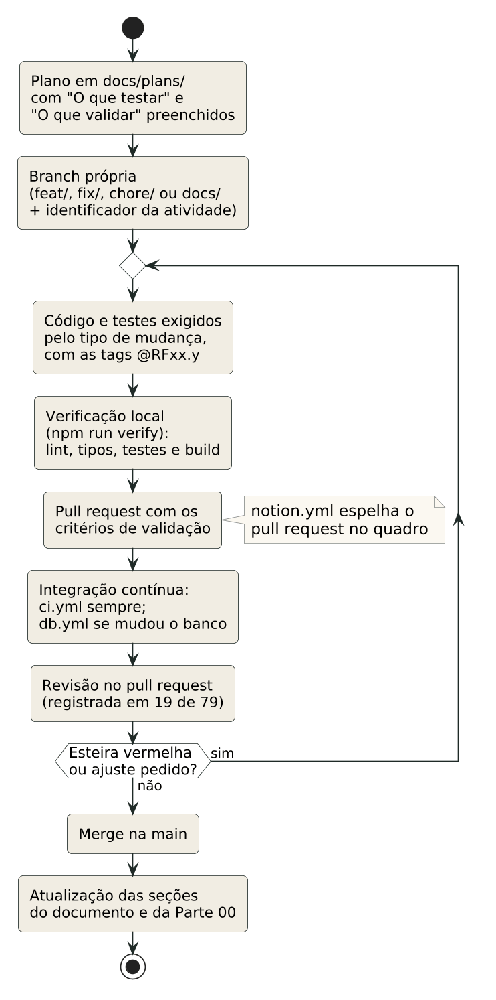
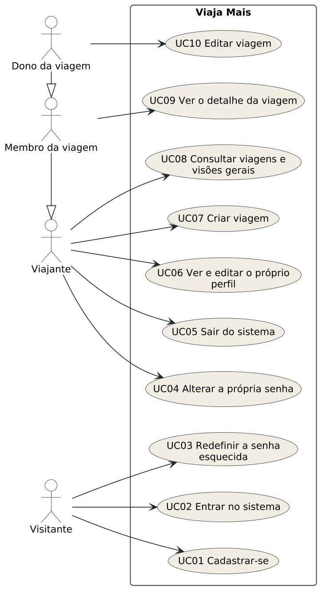
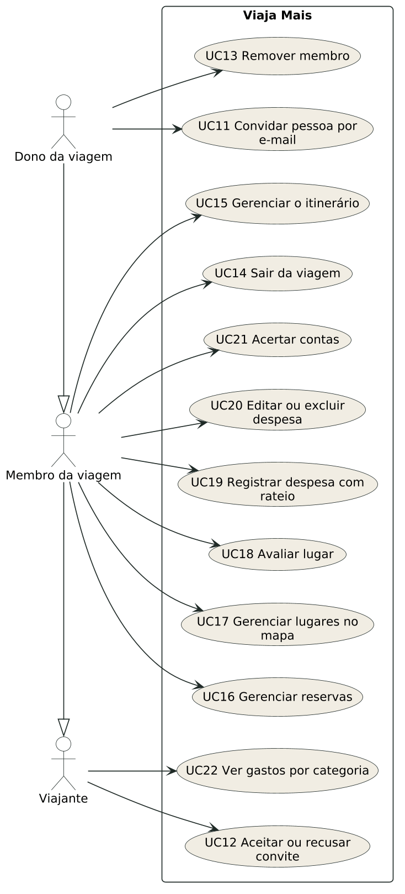
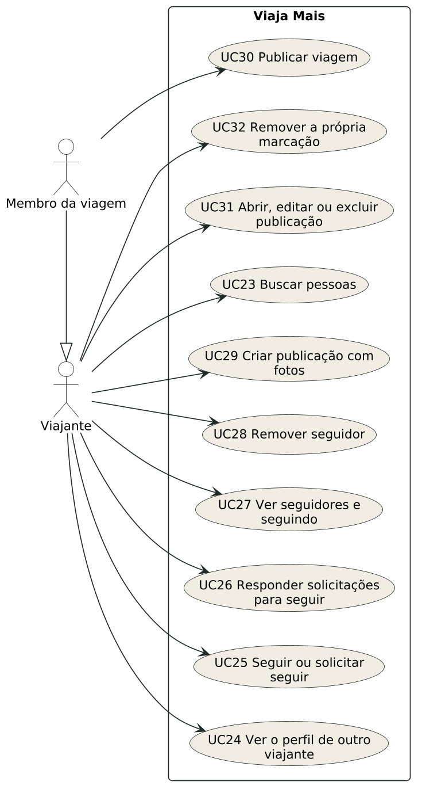

## 17 Gestão do Projeto e Modelagem do Sistema

### 17.1 Organização do Projeto

O grupo tem quatro integrantes, e a divisão de tarefas segue fatias verticais por domínio: cada pessoa responde por todo o caminho de uma funcionalidade do seu domínio, da rota de API à tela e ao teste. Preferimos essa divisão à divisão por camada porque ela reduz a espera entre integrantes, e quem implementa sabe onde a própria funcionalidade é frágil, o que orienta os testes que escreve.

| Integrante | Domínio | Grupos de requisitos |
|---|---|---|
| Fernando | Plataforma: banco, autenticação, autorização, integração contínua | RF01, RF04, RNF01, RNF02, RNF04, RNF06 |
| Audrey | Viagem, itinerário, reservas, lugares e qualidade | RF03, RF05, RF07, RF08, RF11, RNF03, RNF05 |
| Micael | Rede social, perfil e IA de roteiros | RF02, RF09, RF10, RF12, RF13 |
| Abner | Financeiro: despesas, rateio e acerto de contas | RF06 |

Duas regras protegem as fronteiras entre domínios. A primeira: nenhum integrante consulta diretamente uma tabela de outro domínio. O responsável expõe uma função em `lib/`, e os demais a consomem. Por exemplo, o domínio social obtém os dados de uma viagem para publicação por `projecaoPublicaDaViagem`, em `lib/trips/publico.ts`, sem ler as tabelas de viagem.

A segunda: toda migration e toda política de RLS (segurança em nível de linha do PostgreSQL), em qualquer domínio, são escritas ou revisadas pelo responsável pela plataforma. O motivo é o modo de falha: uma política errada não gera erro visível, ela expõe dados ou devolve resultado vazio sem aviso.

O semestre foi dividido em 14 semanas (S01 a S14, de 26 de agosto a 1º de dezembro de 2026) e em cinco trilhas: consolidação e segurança do código herdado (T1), divisão de custos (T2), rede social (T3), IA de roteiros (T4) e qualidade e segurança, contínua (T5). O cronograma e o marco de cada semana estão em `docs/plans/00-plano-norte.md`.

A unidade de acompanhamento é a atividade, identificada por semana, inicial do responsável e assunto, como `S03-A-editar-viagem`. Cada atividade tem um plano em `docs/plans/` com seis blocos fixos: contexto, arquivos afetados, passos, o que testar, o que validar e evidência. Os blocos de teste e validação são preenchidos antes da implementação, e o tipo da atividade define os testes obrigatórios (seção 24).

A Figura 17.1 mostra o ciclo de uma atividade. O plano é criado com os critérios de teste e de validação, e a atividade ganha uma branch própria. O laço central é o trabalho até o merge: código e testes com as marcações de requisito, verificação local, pull request com os critérios colados, integração contínua e revisão. O laço se repete enquanto a esteira falha ou a revisão pede ajuste.

O fluxo `ci.yml` roda em todo pull request; o `db.yml`, que aplica as migrations do zero e executa os testes de RLS, só quando o pull request toca o banco. A nota ao lado do pull request indica que o fluxo `notion.yml` espelha o pull request no quadro do Notion, que serve só para acompanhamento: os planos continuam no repositório. Depois do merge, as seções do documento afetadas e a Parte 00 são atualizadas.

A comunicação entre domínios acontece no próprio pull request, onde o pedido de outro domínio é registrado com o contrato esperado. Na publicação de viagem, o domínio social pediu a função de recorte público da viagem; ela foi entregue em uma atividade própria (S11-A-helper-publicar), e um defeito apontado depois foi corrigido com teste de regressão (S14-A-congelamento-a).

A tabela resume os dados de processo do semestre, extraídos do git e da API do GitHub em 22/11/2026 (`docs/pfc/evidencias/2026-11-22/metricas.md`).

| Indicador (26/08 a 22/11/2026) | Valor |
|---|---|
| Planos de atividade em `docs/plans/` | 81 |
| Pull requests abertos | 84: 77 integrados, 7 fechados sem integração |
| Tempo entre abrir e integrar | Mediana de 1,0 h; P90 de 7,2 dias |
| Pull requests com revisão registrada | 19 de 84 |
| Commits na `main`, sem merges | 171: Fernando 82, Micael 58, Audrey 15, Abner 14, agente automatizado 2 |
| Commits por tipo | feat 60, fix 35, docs 30, chore 21, test 11, outros 14 |
| Requisitos marcados no código e com teste | 79 marcados e 83 com teste, de 140 no catálogo |

Os dados mostram um desvio do processo planejado. A revisão por outra pessoa estava prevista para todo pull request, mas só 19 dos 84 têm revisão registrada no GitHub. Nos demais, a garantia antes do merge veio da esteira automatizada. A mediana de 1,0 h entre abrir e integrar é coerente com esse quadro: a maior parte dos pull requests foi integrada sem esperar revisão.

A distribuição dos commits também é desigual: Fernando e Micael somam 140 dos 171. Contagem de commits não mede esforço, porque o tamanho de cada um varia, mas a diferença é grande o bastante para indicar carga desigual entre os domínios. A plataforma e a rede social concentraram a maior parte dos requisitos novos do semestre.

### 17.2 Modelagem e Diagramas

#### Casos de uso

Os casos de uso foram divididos em três figuras por assunto: conta e viagem, grupo e finanças, e rede social. Só entram casos de uso com tela e rota em funcionamento, ainda que alguns realizem requisitos parciais, indicados na tabela; as telas que são apenas prévia ficam de fora e são listadas ao fim desta subseção. Cada caso de uso tem um identificador (UC01 a UC32), usado na tabela que os liga aos requisitos.

São quatro atores. O **Visitante** ainda não tem sessão. O **Viajante** é qualquer pessoa autenticada. O **Membro da viagem** é o viajante que participa de uma viagem, por tê-la criado ou por ter aceitado um convite. O **Dono da viagem** é o membro que a criou. As setas de generalização indicam herança: o dono faz tudo o que o membro faz, e o membro tudo o que o viajante faz.

Na Figura 17.2, o Visitante alcança apenas os casos de identidade: cadastrar-se, entrar e redefinir a senha esquecida (UC01 a UC03). O Viajante cuida da própria conta (UC04 a UC06), cria viagens e consulta a lista delas e as visões gerais de agenda, reservas e lugares (UC07 e UC08).

Ver o detalhe de uma viagem (UC09) exige ser membro, e editá-la (UC10) exige ser o dono. A rota de exclusão de viagem existe e é testada, mas nenhuma tela a chama; por isso a exclusão não aparece como caso de uso.

Na Figura 17.3, o Dono convida pessoas por e-mail e remove membros (UC11 e UC13). O convite é respondido pelo Viajante convidado (UC12), que ainda não é membro: aceitar é o que o torna membro. O Membro pode sair da viagem (UC14) e trabalha no conteúdo dela: itinerário, reservas, lugares e avaliações de lugares (UC15 a UC18).

Ainda na Figura 17.3, o Membro registra despesas com rateio (UC19) e participa do acerto de contas (UC21), em que vê o saldo de cada um e registra os pagamentos que fez. Editar ou excluir uma despesa (UC20) cabe ao autor dela ou ao dono da viagem. Ver gastos por categoria (UC22) é do Viajante porque a tela Finanças soma as despesas de todas as viagens de que ele participa.

Na Figura 17.4, quase todos os casos são do Viajante: buscar pessoas, ver perfis, seguir, responder solicitações, ver e podar a própria rede (UC23 a UC28), criar, editar e excluir publicações e remover uma marcação feita por outra pessoa (UC29, UC31 e UC32). Publicar viagem (UC30) é do Membro, porque só quem participa de uma viagem pode publicá-la.

A separação entre Membro e Dono não é apenas conceitual. Ela corresponde às duas funções de autorização do servidor, `exigirMembro` e `exigirDono`, em `lib/authz/trip.ts`, e às políticas de RLS do banco. Montar o itinerário, por exemplo, é trabalho do grupo, e a rota exige só participação; editar título e datas da viagem exige ser o dono.

#### Casos de uso e requisitos

A tabela liga cada caso de uso aos requisitos funcionais da seção 14 que ele realiza. Todo caso de uso das três figuras aparece nela, e nenhum caso de uso fora delas.

| UC | Caso de uso | Ator principal | Requisitos |
|---|---|---|---|
| UC01 | Cadastrar-se | Visitante | RF01.1, RF01.2 |
| UC02 | Entrar no sistema | Visitante | RF01.3, RF01.5, RF01.6 |
| UC03 | Redefinir a senha esquecida | Visitante | RF01.7 |
| UC04 | Alterar a própria senha | Viajante | RF01.8, RF02.3 |
| UC05 | Sair do sistema | Viajante | RF01.4 |
| UC06 | Ver e editar o próprio perfil | Viajante | RF02.1, RF02.2, RF02.5, RF02.6, RF02.7 |
| UC07 | Criar viagem | Viajante | RF03.1, RF03.6 |
| UC08 | Consultar viagens e visões gerais | Viajante | RF03.4, RF07.7 |
| UC09 | Ver o detalhe da viagem | Membro | RF03.5, RF04.4 |
| UC10 | Editar viagem | Dono | RF03.2, RF03.8 |
| UC11 | Convidar pessoa por e-mail | Dono | RF04.1, RF04.2 |
| UC12 | Aceitar ou recusar convite | Viajante | RF04.3 |
| UC13 | Remover membro | Dono | RF04.7 |
| UC14 | Sair da viagem | Membro | RF04.8 |
| UC15 | Gerenciar o itinerário | Membro | RF04.5, RF05.1 a RF05.7 |
| UC16 | Gerenciar reservas | Membro | RF07.1 a RF07.6 |
| UC17 | Gerenciar lugares no mapa | Membro | RF08.1 a RF08.6 |
| UC18 | Avaliar lugar | Membro | RF11.1, RF11.2, RF11.3 |
| UC19 | Registrar despesa com rateio | Membro | RF04.6, RF06.1, RF06.9, RF06.10 |
| UC20 | Editar ou excluir despesa | Membro (autor) ou Dono | RF06.2, RF06.3 |
| UC21 | Acertar contas | Membro | RF06.11, RF06.13 |
| UC22 | Ver gastos por categoria | Viajante | RF06.4, RF06.5 |
| UC23 | Buscar pessoas | Viajante | RF09.10, RF09.12 |
| UC24 | Ver o perfil de outro viajante | Viajante | RF02.8, RF09.16 |
| UC25 | Seguir ou solicitar seguir | Viajante | RF09.1, RF09.2, RF09.5 |
| UC26 | Responder solicitações para seguir | Viajante | RF09.3, RF09.4, RF13.2 |
| UC27 | Ver seguidores e seguindo | Viajante | RF09.6 |
| UC28 | Remover seguidor | Viajante | RF09.9 |
| UC29 | Criar publicação com fotos | Viajante | RF09.13, RF09.15 |
| UC30 | Publicar viagem | Membro | RF09.7, RF09.13 |
| UC31 | Abrir, editar ou excluir publicação | Viajante | RF09.13, RF09.17 |
| UC32 | Remover a própria marcação | Viajante | RF09.14 |

Ficam fora dos diagramas, por não estarem implementados: a lista do feed e as sugestões (RF09.8 e RF09.11), que hoje são prévia; curtidas e comentários (RF10); a geração de roteiro por IA (RF12), que é prévia; a escolha de quem pagou a despesa (RF06.8), que o banco suporta mas o formulário não oferece; a quitação de parcela (RF06.12); e a compra de voos e hotéis, que é prévia e não tem requisito no catálogo.

#### Fluxo das operações

Os diagramas de sequência das operações de escrita estão na seção 22.2, junto com o catálogo das rotas que seguem cada padrão.
