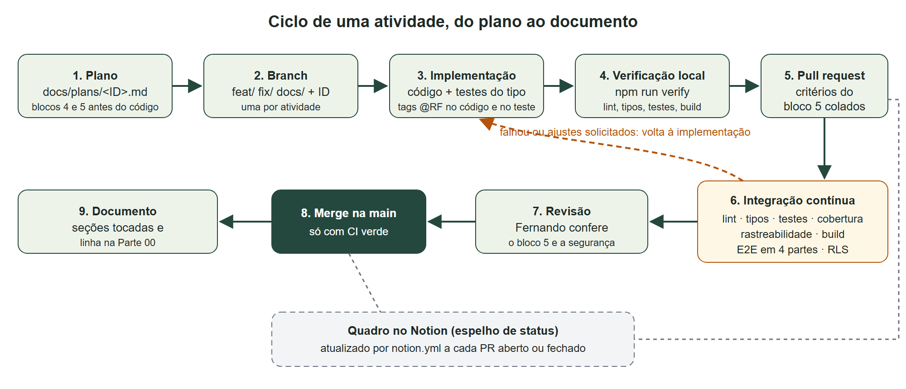
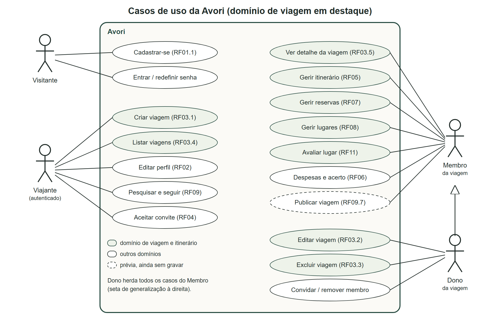
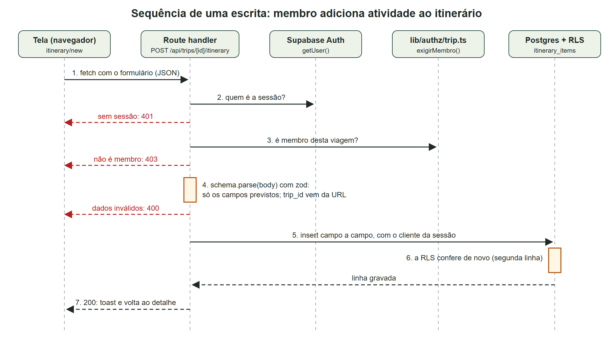

## 17. Gestão do Projeto e Modelagem do Sistema

### 17.1 Organização do Projeto

O grupo tem quatro integrantes, e a divisão de tarefas segue fatias **verticais** por domínio do sistema: cada pessoa é responsável por todo o caminho de uma funcionalidade do seu domínio, da rota de API à tela e ao teste. Preferimos essa divisão à divisão por camada (uma pessoa no banco, outra nas telas) porque ela reduz a dependência entre integrantes: quem implementa uma tela não precisa esperar outra pessoa terminar a rota correspondente, e a pessoa responsável sabe onde a própria funcionalidade é frágil, o que orienta os testes que escreve.

| Integrante | Domínio | Grupos de requisitos |
|---|---|---|
| Fernando | Plataforma: banco, autenticação, autorização, integração contínua | RF01, RF04, RNF01, RNF02, RNF04, RNF06 |
| Audrey | Viagem, itinerário, reservas e lugares, e qualidade | RF03, RF05, RF07, RF08, RNF03, RNF05 |
| Micael | Rede social, perfil e IA de roteiros | RF02, RF09, RF10, RF12, RF13 |
| Abner | Financeiro: despesas, rateio e acerto de contas | RF06 |

Duas regras protegem as fronteiras entre domínios. A primeira é que nenhum integrante consulta diretamente uma tabela de outro domínio: o responsável expõe uma função em `lib/`, e os demais a consomem. Um exemplo é `projecaoPublicaDaViagem`, em `lib/trips/publico.ts`, pela qual o domínio social obtém os dados de uma viagem para publicação sem ler as tabelas de viagem. A segunda é que toda migration e toda política de RLS, em qualquer domínio, são escritas ou revisadas pelo responsável pela plataforma, porque uma política errada não gera erro visível: ela expõe dados ou devolve resultado vazio sem nenhum aviso.

O semestre foi dividido em 14 semanas (S01 a S14, de setembro a 1º de dezembro de 2026) e em cinco trilhas de trabalho: consolidação e segurança do código herdado (T1), divisão de custos (T2), rede social (T3), IA de roteiros (T4) e qualidade e segurança, contínua (T5). O cronograma completo e o marco de cada semana estão em `docs/plans/00-plano-norte.md`.

A unidade de acompanhamento é a **atividade**, identificada por semana, inicial do responsável e assunto, como `S03-A-editar-viagem`. Cada atividade tem um plano em `docs/plans/`, com cabeçalho estruturado (responsável, revisor, semana, requisitos, seções do documento, branch, tipo e status) e seis blocos fixos: contexto, arquivos afetados, passos, o que testar, o que validar e evidência. Os blocos "O que testar" e "O que validar" são preenchidos antes da implementação, e o tipo da atividade define quais testes são obrigatórios (seção 24.2). Até 19/11/2026, o repositório reunia 77 planos de atividade.

*Figura 17.1 — Ciclo de uma atividade, do plano ao documento.* A primeira linha mostra o trabalho de quem implementa: o plano é criado com os critérios de teste e de validação (1), a atividade ganha uma branch própria (2), o código e os testes exigidos pelo tipo são escritos com as marcações de requisito (3) e a verificação local executa lint, tipos, testes e build (4) antes da abertura do pull request, que traz colados os critérios do bloco 5 (5). A segunda linha mostra o caminho até a branch principal: a integração contínua (6) executa as verificações descritas na seção 24.3; a revisão (7) é feita pelo responsável pela plataforma, que confere os critérios e a segurança; e o merge (8) só ocorre com todas as verificações aprovadas. Por fim, as seções do documento afetadas pela atividade e a Parte 00 são atualizadas (9). A seta tracejada indica o retorno à implementação quando a integração contínua falha ou a revisão pede ajustes. Abaixo, o quadro no Notion funciona apenas como espelho de status: o fluxo `notion.yml` atualiza o cartão da atividade quando um pull request é aberto ou fechado, e o repositório continua sendo a fonte dos planos.

A comunicação entre domínios acontece no próprio pull request. Quando uma funcionalidade depende de outro domínio, o pedido é registrado como comentário, com o contrato esperado. Na publicação de viagem, por exemplo, o domínio social pediu a função de recorte público da viagem; ela foi entregue em uma atividade própria (S11-A-helper-publicar), e um defeito apontado depois, na revisão, foi corrigido com teste de regressão (S14-A-congelamento-a).

### 17.2 Modelagem e Diagramas

#### Casos de uso

*Figura 17.2 — Casos de uso da Avori, com o domínio de viagem e itinerário em destaque.* O retângulo delimita o sistema, e os bonecos à esquerda e à direita são os atores. O **Visitante** ainda não tem sessão e pode apenas cadastrar-se, entrar ou redefinir a senha. O **Viajante** é qualquer pessoa autenticada: cria viagens, vê a lista das viagens de que participa, edita o próprio perfil, pesquisa e segue outras pessoas e aceita convites. Ao criar uma viagem ou aceitar um convite, o Viajante passa a ser **Membro** daquela viagem, o que lhe dá acesso ao detalhe e às abas da viagem: itinerário, reservas, lugares, avaliações de lugares e despesas. O **Dono** é o membro que criou a viagem; a seta de generalização indica que ele herda todos os casos de uso do Membro e acrescenta os que alteram a viagem como um todo: editar, excluir, convidar e remover membros.

A separação entre Membro e Dono não é apenas conceitual. Ela corresponde às duas funções de autorização do servidor, `exigirMembro` e `exigirDono`, em `lib/authz/trip.ts`, e às políticas de RLS do banco. Montar o itinerário, por exemplo, é trabalho do grupo, e por isso a rota de atividades exige apenas participação na viagem; editar o título ou as datas da viagem exige ser o dono. As elipses preenchidas marcam os casos de uso do domínio de viagem e itinerário; a elipse tracejada, "Publicar viagem", indica uma funcionalidade que nesta versão funciona como prévia visual, sem gravar dados.

#### Fluxo de uma operação de escrita

*Figura 17.3 — Diagrama de sequência da inclusão de uma atividade no itinerário.* As colunas são os participantes da operação, e as linhas tracejadas verticais representam o tempo, de cima para baixo. A tela envia o formulário ao route handler `POST /api/trips/[id]/itinerary` (1), que primeiro identifica a sessão no Supabase Auth (2) e, sem ela, responde 401. Em seguida, pergunta a `exigirMembro` se o usuário participa da viagem (3), respondendo 403 em caso negativo. Só então valida o corpo da requisição com o schema zod (4), que aceita apenas os campos previstos e responde 400 a dados inválidos; o identificador da viagem vem do endereço já autorizado, e não do corpo. A gravação (5) copia campo a campo o resultado validado, o que impede a atribuição em massa, e usa o cliente com a sessão do usuário, de modo que a RLS do banco confere a permissão uma segunda vez (6). Com a linha gravada, a tela recebe a resposta 200, exibe a notificação de sucesso e volta ao detalhe da viagem (7).

Escolhemos esse caso para o diagrama porque ele é o molde de todas as escritas do sistema: viagens, reservas, lugares, avaliações e despesas seguem a mesma ordem de verificações. As três saídas de erro, em vermelho, correspondem exatamente aos caminhos 401, 403 e 400 que o teste de integração de cada rota é obrigado a cobrir (seção 24.2), e a dupla verificação, no servidor e na RLS, é a medida de defesa em profundidade detalhada na seção 25.
