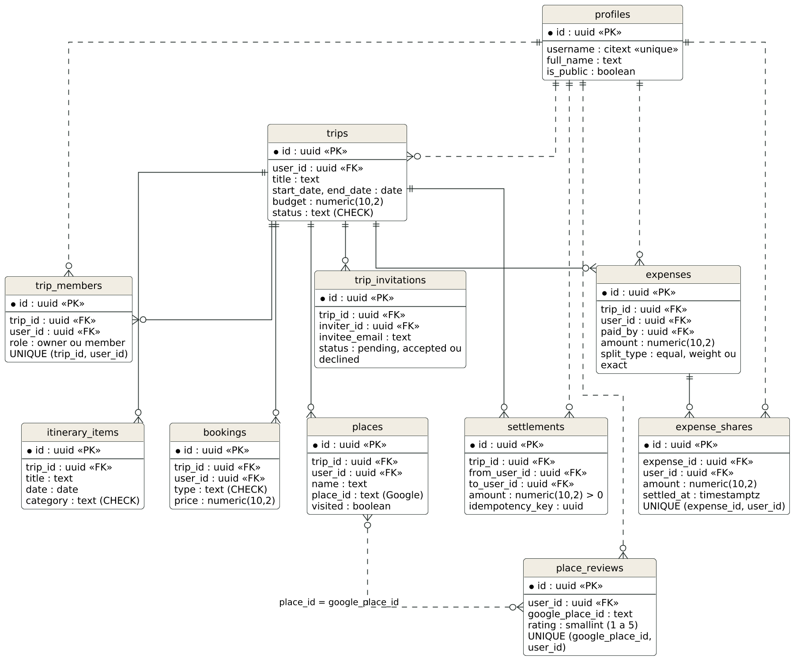
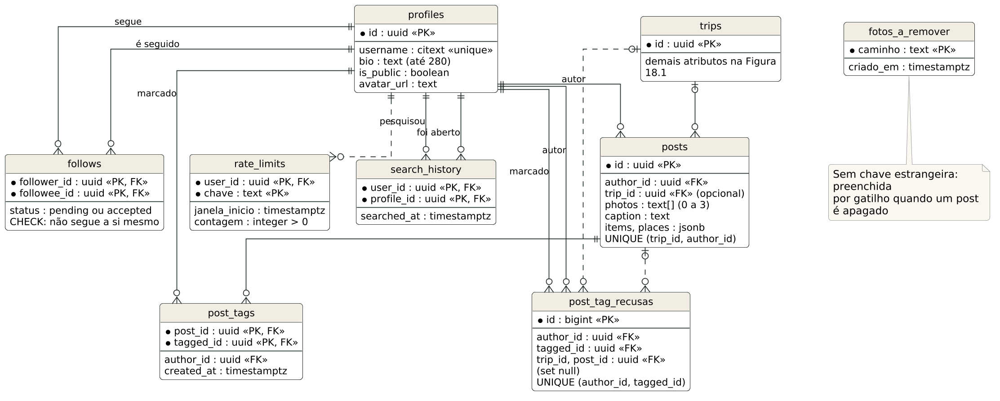

## 18 Dados e Modelagem da Informação

### 18.1 Modelo de Dados

O modelo corresponde ao schema versionado nas 22 migrations de `supabase/migrations/`, aplicáveis em base limpa, e aos tipos gerados em `types/database.ts`. São 18 tabelas no esquema `public`, apresentadas em duas figuras: viagem e financeiro (Figura 18.1) e rede social e plataforma (Figura 18.2).

Em cada entidade mostramos a chave primária, as chaves estrangeiras e os atributos que explicam as regras de negócio; os demais estão nas migrations. As linhas usam a notação de pé de galinha: o traço duplo indica "exatamente um", e o círculo com o pé, "zero ou muitos".

A identidade do usuário (e-mail e senha) pertence ao serviço de autenticação do Supabase, na tabela `auth.users`, que fica fora das figuras porque não é modelada nem alterada por nós. A tabela `profiles` usa a mesma chave e é criada por um gatilho no cadastro (`handle_new_user`), o que impede existir usuário sem perfil. O e-mail não é copiado para `profiles`, e por isso ler o perfil de outra pessoa não expõe o contato dela.

Nas figuras, `profiles` representa o usuário. As linhas tracejadas que saem dela indicam chaves que, no banco, referenciam `auth.users(id)`: o valor é o mesmo de `profiles.id`, mas a restrição aponta para a tabela do serviço de autenticação. As linhas contínuas são chaves estrangeiras entre tabelas do esquema `public`.

A entidade central da Figura 18.1 é `trips`. As tabelas que pertencem a uma viagem se ligam a ela por chave estrangeira com exclusão em cascata: apagar a viagem apaga membros, convites, itinerário, reservas, lugares, despesas e acertos, sem deixar registros órfãos.

A participação é modelada à parte, em `trip_members`, com unicidade sobre o par viagem e usuário e papel restrito a `owner` ou `member`. Um gatilho (`add_trip_owner_as_member`) registra o criador como dono na mesma transação que insere a viagem. Separar viagem e participação é o que permite que o critério de acesso seja participar, e não ter criado.

Os convites ficam em `trip_invitations`, endereçados a um e-mail, com situação pendente, aceito ou recusado. Aceitar o convite é o único caminho para entrar em uma viagem: a política de inserção em `trip_members` exige um convite pendente para o e-mail da própria sessão.

As tabelas de conteúdo seguem o mesmo padrão: vínculo obrigatório com a viagem e, quando há autoria, com o usuário. Campos de classificação não são texto livre: categoria, situação e tipo são restritos por `CHECK` no banco, de modo que nenhuma gravação, por qualquer caminho, cria uma categoria ou um tipo de reserva inexistente. Os cinco tipos de reserva convivem em `bookings`, distinguidos pelo campo `type`.

No financeiro, `expenses.paid_by` separa quem pagou de quem registrou a despesa e usa `on delete restrict`: apagar a conta de quem pagou destruiria o histórico do grupo. O campo `split_type` aceita só `equal`, `weight` ou `exact`. A tabela `expense_shares` guarda uma parcela por pessoa e despesa, garantida por unicidade, com valor não negativo e data de quitação.

Um gatilho de restrição adiado para o fim da transação confere que a soma das parcelas é igual ao valor da despesa. Ele é adiado porque as parcelas são inseridas uma a uma, e a soma parcial não fecha no meio do caminho. Assim, nenhuma gravação, da aplicação ou direta no banco, deixa o rateio inconsistente.

Os pagamentos entre participantes ficam em `settlements`, separados das parcelas, porque uma transferência sugerida pode compensar várias despesas. O registro é imutável: não há política nem permissão de alteração ou exclusão. O banco recusa valor menor ou igual a zero, pagamento para si mesmo e moeda fora do formato de três letras maiúsculas. A chave de idempotência, única por pagador, impede duplicar um pagamento por clique duplo.

A figura desenha uma só linha entre `profiles` e `settlements`, mas há duas chaves, `from_user_id` e `to_user_id`, ambas com `on delete restrict`. Valores monetários são `numeric(10,2)` no banco, e não ponto flutuante; os cálculos de rateio e de saldo em `lib/finance/` trabalham em centavos inteiros, porque erro de arredondamento vira divergência de centavos entre pessoas.

A avaliação de lugar, em `place_reviews`, se liga ao identificador do Google (`google_place_id`), e não a `places.id`; a linha tracejada rotulada entre as duas tabelas indica essa ligação lógica, sem chave estrangeira. Cada viagem guarda a própria cópia do lugar; presa a `places.id`, a avaliação de um viajante nunca apareceria para outro. A nota vai de 1 a 5, o comentário tem até 1.000 caracteres, e cada pessoa tem uma avaliação por lugar.

Na Figura 18.2, `profiles` recebeu as colunas da rede social. O nome de usuário é `citext`, para que a busca ignore maiúsculas, único, restrito ao formato de 3 a 30 caracteres minúsculos, números e sublinhado, e recusa nomes reservados e qualquer nome com a marca. A biografia tem até 280 caracteres. Perfis novos nascem públicos; as contas anteriores à rede social ficaram privadas, porque não consentiram em ser descobertas.

A tabela `follows` registra quem segue quem, com chave composta pelo par e uma restrição que impede seguir a si mesmo. A situação inicial é definida por gatilho, aceita para perfil público e pendente para privado, e o cliente não pode escolhê-la. A tabela `search_history` guarda os perfis abertos pela pesquisa, também com chave composta e sem permitir o próprio perfil.

A tabela `posts` substituiu `trip_posts` em 18/11/2026, quando a publicação de viagem passou a ser um caso particular de publicação. A viagem é opcional: o post de fotos tem de uma a três fotos e não guarda viagem; o post de viagem copia título, destino, datas, roteiro e lugares, e nunca despesas, orçamento ou membros. Uma restrição de coerência impede meio-termo entre as duas formas, e a unicidade sobre viagem e autor limita a um post por membro e viagem.

As marcações ficam em `post_tags`, com chave composta por post e pessoa marcada e sem permitir marcar a si mesmo; a coluna `author_id`, que repete o autor do post, não tem linha própria na figura. Quando alguém remove uma marca, o gatilho grava a recusa em `post_tag_recusas`, única por autor e pessoa. A recusa sobrevive ao post e à viagem (`on delete set null`): se morresse com eles, o autor a apagaria apagando o próprio post. As linhas tracejadas que chegam a essa tabela representam essas duas chaves opcionais.

Duas tabelas são da plataforma e não têm acesso pela aplicação. `fotos_a_remover` é uma fila preenchida por gatilho quando um post sai do banco; o servidor a esvazia removendo os arquivos do Storage. `rate_limits` conta requisições por usuário e regra, em janela fixa, e só a função `consumir_limite` escreve nela.

Duas decisões valem para todo o modelo. As chaves primárias são UUID gerados pelo banco, o que evita expor contagem de registros em endereços. E toda chave estrangeira tem índice: a migration de 13/11/2026 criou os 15 que faltavam nas tabelas herdadas, e o teste `tests/rls/15-indices.test.ts` falha se uma chave nova chegar sem índice (seção 19.2).

### 18.2 Estrutura e Manipulação de Dados

Os dados ficam em PostgreSQL, fornecido pelo Supabase como serviço gerenciado. Instantes, como criação e quitação, são gravados com fuso horário; datas de viagem e de atividade, como data simples. As fotos de perfil e de publicações ficam no Storage do Supabase, em buckets privados, e o banco guarda apenas o caminho do arquivo; a tela recebe uma URL assinada, com validade limitada.

A estrutura do banco é tratada como código. Cada alteração é uma migration nomeada por data, hora e domínio, versionada no repositório. Os tipos da aplicação são gerados a partir do schema, e por isso uma divergência entre código e banco aparece como erro de compilação. O fluxo `db.yml` sobe um banco efêmero e aplica as migrations do zero a cada mudança no banco.

A leitura pode ocorrer nos componentes renderizados no servidor, com o cliente da sessão do usuário, sujeito à RLS. A escrita passa sempre por um route handler em `app/api/`, que confere a sessão, chama `exigirMembro` ou `exigirDono` quando a rota toca uma viagem, valida o corpo com um esquema zod e copia os campos validados um a um, sem espalhar o corpo da requisição (seção 22).

Sobre esse caminho atua a RLS do próprio banco, segunda linha de defesa. As 18 tabelas têm RLS habilitada e políticas escritas por extenso, conferidas pelo teste `tests/rls/00-estrutura.test.ts`. As políticas usam funções auxiliares: `is_trip_member`, `is_trip_owner` e `can_access_trip` para viagens; `pode_acessar_despesa` e `pode_editar_despesa` para o rateio; `pode_ver_rede` e `social_pode_marcar` para a rede social.

Permissões por coluna completam as políticas: a política limita qual linha, a permissão limita quais colunas. Em `posts`, por exemplo, a coluna `trip_id` não pode ser lida pelos usuários, porque dois posts com a mesma viagem revelariam quem viajou junto.

A chave de serviço, que ignora a RLS, fica em `lib/supabase/admin.ts` e é usada só em route handlers, para o que a sessão do usuário não pode fazer: enviar, assinar e remover arquivos no Storage, enviar o e-mail de convite e esvaziar a fila de fotos. As demais operações usam o cliente com a sessão, e as políticas valem também para o código do servidor.

| Tabela | Finalidade | Quem lê | Quem escreve |
|---|---|---|---|
| `profiles` | Dados públicos do usuário | Qualquer autenticado | Gatilho no cadastro; o próprio usuário, pela rota de perfil |
| `trips` | Viagem | Membros | Criador; edição só do dono |
| `trip_members` | Participação e papel | Membros | Gatilho na criação; convidado ao aceitar; saída e remoção pela rota |
| `trip_invitations` | Convite por e-mail | Dono e convidado | Dono cria; convidado aceita ou recusa |
| `itinerary_items` | Atividades do roteiro | Membros | Membros |
| `bookings` | Reservas | Membros | Membros |
| `places` | Lugares salvos | Membros | Membros |
| `place_reviews` | Avaliações de lugares | Qualquer autenticado | Autor, com o lugar salvo em viagem sua |
| `expenses` | Despesas | Membros | Membros criam; autor ou dono editam |
| `expense_shares` | Parcelas do rateio | Membros | Rota de despesas, junto com a despesa |
| `settlements` | Pagamentos de acerto | Membros | Só o pagador; sem alteração |
| `follows` | Quem segue quem | As partes e quem vê a rede | Quem segue; dono aprova, recusa ou remove |
| `search_history` | Perfis abertos na pesquisa | O próprio usuário | O próprio usuário |
| `posts` | Publicações | Conforme a visibilidade do autor | Autor |
| `post_tags` | Marcações | Marcado, autor e quem vê a rede do marcado | Autor marca; marcado remove |
| `post_tag_recusas` | Marcas recusadas | Autor e marcado | Só o gatilho de `post_tags` |
| `fotos_a_remover` | Fila de arquivos a apagar | Chave de serviço | Gatilho de `posts` |
| `rate_limits` | Limite de requisições | Ninguém pela aplicação | Função `consumir_limite` |

A tabela mostra o desenho de acesso por participação: quase tudo o que pertence a uma viagem é lido por todos os membros, porque viagem é trabalho de grupo, e as exceções são as escritas que mudam a viagem como um todo ou o dinheiro de outra pessoa. As provas desse desenho são os 473 testes de RLS e de integração com banco real, que rodam com dois usuários e conferem que um não alcança os dados do outro (seção 25).
