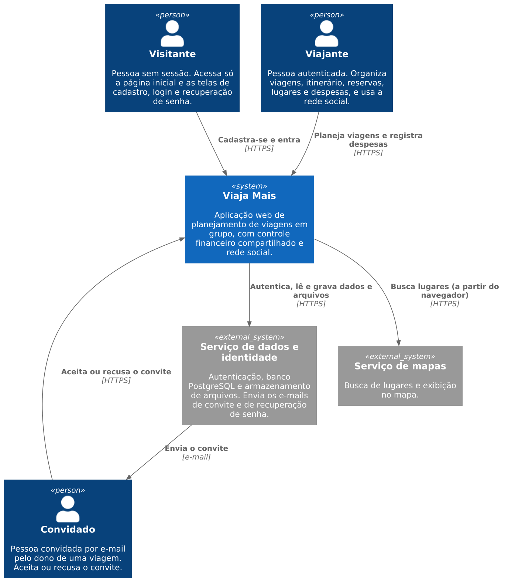
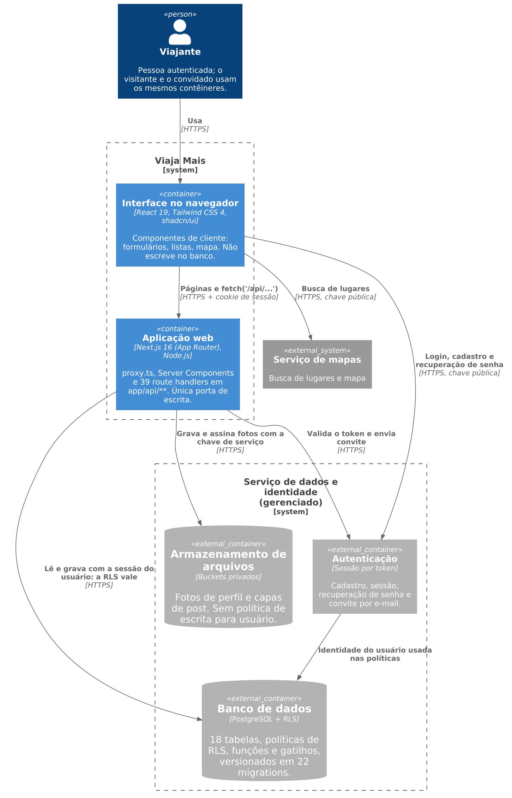
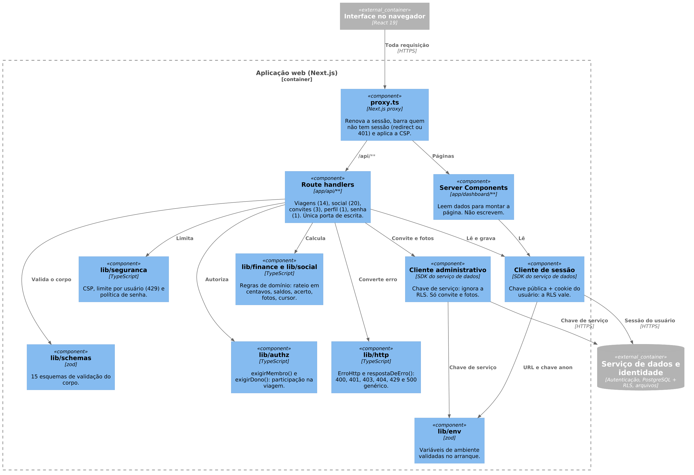
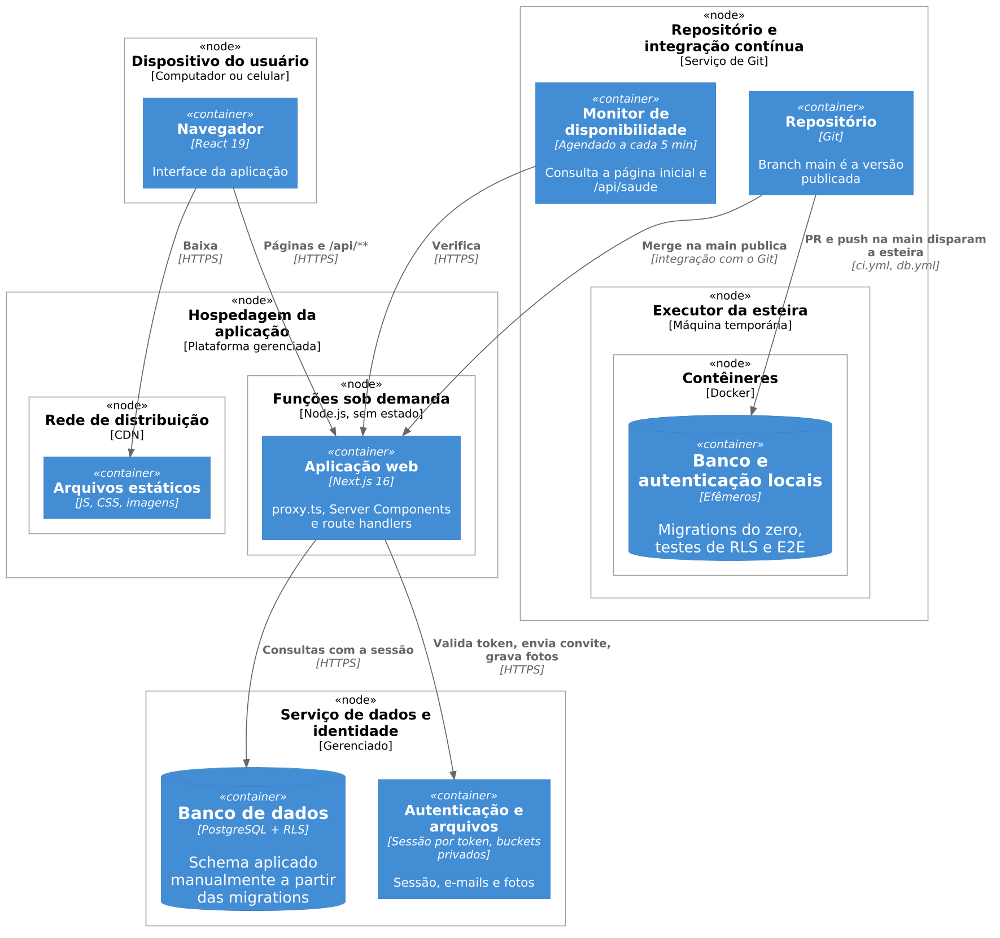
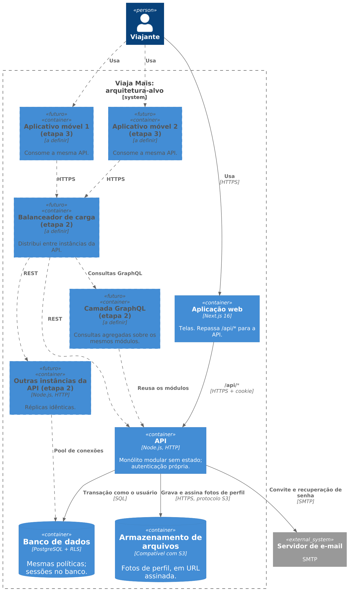

## 20 Arquitetura Geral do Sistema

O Viaja Mais é uma aplicação web organizada em três partes: a interface que executa no navegador, uma aplicação Next.js hospedada na Vercel, que atende as páginas e as rotas de dados no mesmo projeto, e um projeto Supabase, que fornece autenticação, banco PostgreSQL e armazenamento de arquivos. A regra que estrutura essa divisão é que nenhuma escrita em tabela parte do navegador: toda alteração de dado passa por uma rota de servidor.

Descrevemos a arquitetura com o modelo C4, que representa o software em níveis sucessivos de detalhe: contexto, contêineres e componentes. A subseção 20.3 trata da implantação, a 20.4 confronta as decisões com os requisitos não funcionais da seção 15 e a 20.5 apresenta a migração planejada para um backend separado. A versão avaliada é a da branch `main`; a arquitetura-alvo da 20.5 não está em produção.

As figuras desta seção usam nomes genéricos para os serviços externos e para a infraestrutura, porque o provedor de cada papel pode mudar sem que a arquitetura mude; a subseção 20.5 trata justamente de uma dessas trocas. O texto, por sua vez, nomeia o provedor atual. A correspondência é esta:

| Nas figuras | Provedor atual |
|---|---|
| Serviço de dados e identidade | Supabase: autenticação (GoTrue), PostgreSQL e Storage |
| Hospedagem da aplicação | Vercel: rede de distribuição e funções sob demanda |
| Serviço de mapas | Google Maps Platform: Maps JavaScript API e Places |
| Repositório e integração contínua | GitHub e GitHub Actions |
| Banco e autenticação locais | Supabase local, em contêineres Docker |

### 20.1 Contexto e contêineres

O diagrama de contexto mostra o sistema como uma caixa única e quem se relaciona com ele. Distinguimos três pessoas porque o sistema as trata de forma diferente. O visitante, sem sessão, só alcança a página inicial e as telas de cadastro, login e recuperação de senha, que são as únicas rotas públicas declaradas em `lib/supabase/proxy.ts`. O viajante é a pessoa autenticada. O convidado é quem recebe, por e-mail, o convite do dono de uma viagem e precisa aceitá-lo para participar dela.

Há dois sistemas externos. O Supabase aparece como externo porque é operado pelo fornecedor; o que é nosso dentro dele, isto é, o schema, as políticas de acesso, as funções e a configuração dos buckets, está versionado no repositório. O Google Maps é consumido apenas pelo navegador, em dois componentes de busca de lugares. A chave dele é pública por exigência da própria API; a proteção prevista em `.env.example` é restringi-la por domínio e por cota no painel do provedor.

O diagrama não traz companhias aéreas, redes de hotéis, meios de pagamento nem provedor de inteligência artificial, porque nenhuma dessas integrações existe no código. As telas de compra de passagens e de hospedagem e a de criação de roteiro com a Avori (nome do produto nas telas desde 13/11/2026) são prévias visuais com dados de exemplo.

O diagrama de contêineres abre a caixa do sistema. Dentro do limite do Viaja Mais ficam dois contêineres. A interface no navegador reúne os componentes de cliente em React: formulários, listas e mapa. A aplicação Next.js reúne o `proxy.ts`, que intercepta toda requisição, os Server Components, que leem dados para montar as páginas, e os 39 route handlers de `app/api/**`, que são a única porta de escrita.

No limite do projeto Supabase ficam três contêineres operados pelo fornecedor. O Supabase Auth emite e valida a sessão e envia os e-mails de convite e de recuperação de senha. O PostgreSQL 17 guarda as 18 tabelas, com as políticas de RLS (Row Level Security, segurança em nível de linha), as funções e os gatilhos criados pelas 22 migrations. O Storage guarda dois buckets privados, `avatars` e `capas-posts`, sem nenhuma política de escrita para usuário.

O navegador fala diretamente com dois serviços além da aplicação. O primeiro é o Supabase Auth, apenas nas três telas de autenticação, com a chave anônima: é o único uso do cliente Supabase no navegador. O segundo é o Google Maps. Nenhum dos dois caminhos grava em tabela da aplicação. A versão anterior deste documento registrava como exceção pendente a tela de lugares, que escrevia direto no banco; ela passou a usar as rotas de servidor.

Escolhemos manter páginas e rotas de dados em um único projeto porque isso dá uma linguagem, um build e uma publicação para uma equipe de quatro pessoas em um semestre. O custo dessa escolha é o acoplamento ao Next.js e ao Supabase, que tratamos na subseção 20.5.

### 20.2 Arquitetura interna

O diagrama de componentes detalha a aplicação Next.js. O `proxy.ts` executa antes de qualquer página ou rota. Ele valida o token com `getUser()`, que consulta o servidor de autenticação, devolve redirecionamento para o login quando a página exige sessão e resposta 401 em JSON quando a chamada é para `/api`, e acrescenta a política de segurança de conteúdo montada em `lib/seguranca/csp.ts`. Ele é uma barreira de entrada, não a autorização.

A autorização acontece dentro de cada route handler. Toda rota segue o molde de `app/api/trips/[tripId]/route.ts`, e é essa sequência que chamamos de caminho único de escrita:

1. **Identificar** o usuário com `getUser()`; sem sessão válida, a resposta é 401.
2. **Autorizar** com `exigirMembro()` ou `exigirDono()`, de `lib/authz/trip.ts`, que consultam a participação em `trip_members`; quem não participa recebe 403.
3. **Validar** o corpo com um dos 15 esquemas zod de `lib/schemas`; corpo inválido recebe 400 com o motivo.
4. **Gravar campo a campo**, extraindo cada campo do resultado validado. O corpo da requisição nunca é repassado ao banco, o que impede o cliente de reescrever `user_id` ou `trip_id`.
5. **Converter o erro** com `respostaDeErro()`, de `lib/http.ts`: erro conhecido mantém o status; qualquer outro vira 500 com mensagem genérica e um código no cabeçalho `X-Codigo-Erro`, que localiza a linha no log.

As rotas de convite, troca de senha, foto de perfil e seguir perfil acrescentam um passo entre a autorização e a escrita: `exigirLimite()`, de `lib/seguranca/limite.ts`, conta as chamadas do usuário em uma função do PostgreSQL e responde 429 quando a janela se esgota.

A aplicação tem dois clientes do Supabase, e a diferença entre eles é a decisão de segurança mais importante do diagrama. O cliente de sessão (`lib/supabase/server.ts`) usa a chave anônima e o cookie do usuário, de modo que a RLS vale também no servidor. Se uma rota errar a checagem de `lib/authz`, o banco ainda recusa o acesso: a regra está escrita duas vezes, em lugares com modos de falha diferentes.

O cliente administrativo (`lib/supabase/admin.ts`) usa a chave de serviço, que ignora a RLS. Ele é usado em dois casos que a RLS não resolve: o envio do convite pela interface administrativa do Auth e a gravação, remoção e assinatura de fotos no Storage, feita só depois de a rota conferir os bytes do arquivo e regerar a imagem. O módulo lança erro se for chamado no navegador, e a chave nunca recebe o prefixo `NEXT_PUBLIC_`.

Os módulos `lib/finance` e `lib/social` concentram as regras de domínio em funções sem acesso ao banco, como o rateio calculado em centavos, os saldos, o acerto de contas e o cursor de paginação das publicações. Por não fazerem entrada e saída, são testados de forma unitária. O `lib/env.ts` valida as variáveis de ambiente com zod na inicialização e falha nomeando a variável ausente.

As leituras das telas seguem outro caminho: cinco páginas de `app/dashboard/**` são Server Components que consultam o banco com o cliente de sessão, e as demais buscam os dados nas rotas de `app/api`. Nenhuma página escreve diretamente no banco. Uma limitação do desenho é que o molde é convenção, e não mecanismo do framework: cada rota repete as cinco etapas, e o que garante a repetição são os testes obrigatórios de 200, 401, 403 e 400 e a revisão.

### 20.3 Infraestrutura e implantação

O diagrama de implantação mostra onde cada contêiner executa. No dispositivo do usuário executa a interface. Na Vercel há dois nós: a rede de borda, que entrega os arquivos estáticos a partir do ponto mais próximo do usuário, e as funções sob demanda, que executam a aplicação Next.js sem guardar estado entre requisições. O projeto Supabase de produção hospeda o PostgreSQL, o Auth e o Storage.

O GitHub guarda o repositório e executa a esteira no GitHub Actions. Dentro de cada execução, o Supabase CLI 2.104.0 sobe em Docker um Supabase local e efêmero, com PostgreSQL, Auth e Storage, aplica as migrations do zero e carrega os dois usuários de teste. É o mesmo ambiente que cada integrante sobe na própria máquina com `npm run setup`. Por isso nenhum teste toca o banco de produção e nenhuma credencial de banco é compartilhada. No mesmo serviço roda o monitor de disponibilidade (seção 24.2), que consulta a aplicação publicada a cada cinco minutos.

Um commit chega à produção por este caminho:

1. O pull request dispara o `ci.yml`, que executa lint, verificação de tipos, testes unitários e de rotas, conferência de rastreabilidade e cobertura; o build de produção; e o Playwright em quatro partes paralelas contra o Supabase local, pulado quando só a documentação mudou.
2. Se o pull request altera `supabase/**` ou `tests/rls/**`, o `db.yml` aplica as migrations em banco vazio e executa os testes de isolamento.
3. O merge na `main` faz a Vercel publicar a nova versão pela integração com o GitHub. Nenhum workflow do repositório faz a publicação.
4. A migration não é aplicada pelo merge. Ela é aplicada manualmente no projeto Supabase de produção.

O último passo é a principal limitação da implantação. Entre o merge e a aplicação manual, o código publicado pode esperar uma coluna ou política que o banco de produção ainda não tem, e nada no processo confere se o schema de produção é igual ao do repositório. A esteira prova que as migrations funcionam do zero, mas não que foram aplicadas. Os tempos e as taxas de sucesso da esteira estão na seção 24.

O repositório também tem um `Dockerfile` e um `docker-compose.yml` que geram uma imagem autônoma da aplicação. Eles não são usados na produção, que roda na Vercel, mas mantêm aberta a possibilidade de hospedar a aplicação em contêiner, que a subseção 20.5 aproveita.

### 20.4 Validação da arquitetura frente aos requisitos não funcionais

Para validar a arquitetura, confrontamos cada grupo de requisitos não funcionais da seção 15 com a decisão de arquitetura que deveria atendê-lo e com a evidência que existe no repositório. Classificamos a situação em atendido, parcial ou não atendido. Quando a evidência é uma medição, a tabela traz o número.

| RNF | Decisão de arquitetura | Evidência | Situação |
|---|---|---|---|
| RNF01.1 e RNF01.2 — tempo do painel e da escrita | Leitura no servidor; escrita por rota, com três idas ao banco | p95 de 623 ms (meta 3 s) e de 865 ms (meta 1 s) em produção, 13/11/2026 (`S09-F-desempenho-producao.md`) | Atendido |
| RNF01.3 — 1.000 usuários simultâneos | Funções sem estado; banco único | Com 50 leituras paralelas, a mediana subiu 135% (meta: até 20%); teste de carga não realizado | Não atendido |
| RNF01.4, RNF01.5 e RNF06.4 — paginação, índices e limite | Teto de 500 registros (`lib/listagem.ts`); índice em toda chave estrangeira | `tests/rls/15-indices.test.ts`; consulta de despesas de 12,2 ms para 0,49 ms; listas de viagem sem paginação | Parcial |
| RNF02.4 e RNF02.9 — RLS | Políticas por operação, versionadas; cliente de sessão também no servidor | 473 testes de RLS e de integração com dois usuários, no `db.yml` | Atendido |
| RNF02.5 a RNF02.7 — validação e escrita | Caminho único de escrita; zod; gravação campo a campo | Testes de rota com o caso 400 obrigatório; cliente Supabase do navegador só nas telas de autenticação | Atendido |
| RNF02.8 — limite por usuário | Contador no PostgreSQL, por usuário | `tests/rls/12-rate-limit.test.ts`; falha aberta se o contador cair | Atendido |
| RNF02.10 — chave de serviço | Só em `lib/supabase/admin.ts`, que falha no navegador | Revisão `S10-F-revisao-seguranca.md` | Atendido |
| RNF02.12 — CSP | Política aplicada pelo `proxy.ts` | `tests/lib/csp.test.ts` e `e2e/csp.spec.ts`; admite `'unsafe-inline'` | Parcial |
| RNF03 — usabilidade | shadcn/ui sobre Radix; layout responsivo | E2E em computador e celular; axe-core em parte das telas; só Chromium | Parcial |
| RNF04.1 e RNF04.2 — disponibilidade e backup | Monitor a cada 5 min sobre página e `/api/saude`; backup diário do Supabase | `disponibilidade.yml`, série desde 22/11; backup conferido no painel, sem teste de restauração | Parcial |
| RNF04.3 a RNF04.6 — schema, falhas e ambiente | Migrations versionadas; páginas de erro; `lib/env.ts` | 21 migrations aplicadas do zero no CI; `tests/lib/env.test.ts`; produção aplicada à mão | Atendido, com ressalva |
| RNF05 — manutenibilidade | TypeScript estrito, ESLint, rastreabilidade, regras em `lib/` | 1.511 testes; 97,56% das linhas cobertas; corte de 70% bloqueia o CI; sem log estruturado | Parcial |
| RNF06.1 a RNF06.3 — escala horizontal | Funções sem estado; CDN; pool do Supabase | Sessão no cookie e limite no banco; um único banco, sem réplica | Parcial |
| RNF07 — social e IA | Paginação por cursor nas publicações do perfil | Feed e roteiro por IA são prévias; limite `roteiro-ia` sem rota que o use | Não atendido |
| RNF-08.1 — rateio determinístico | Cálculo em centavos em função pura; gatilho adiado confere a soma | `tests/lib/finance-rateio.test.ts` e `tests/rls/02-rateio.test.ts` | Atendido |

A arquitetura atende bem aos requisitos de segurança e de reprodutibilidade, porque eles foram o critério das decisões centrais: o caminho único de escrita, a autorização em dois níveis e o banco recriado do zero a cada alteração. O ponto mais fraco é tudo o que depende de um único projeto gerenciado em plano gratuito. Há um banco, em uma região, sem réplica nem plano de recuperação verificado, e a camada de aplicação escala sozinha, mas o banco não acompanha.

A latência confirma essa leitura. A escrita cumpre a meta com margem estreita porque cada uma percorre três vezes o caminho até o banco: validação da sessão, checagem de participação e escrita. O custo está na rede, e não no processamento.

Dois achados desta validação merecem registro. O RNF05.4 exige bloqueio pela integração contínua, mas o passo de cobertura do `ci.yml` estava marcado para continuar em caso de erro; a marcação foi removida nesta versão, e uma queda abaixo de 70% passou a reprovar o pull request. Já o RNF04.3 é atendido no repositório, mas a aplicação manual em produção, descrita em 20.3, é uma intervenção que o requisito não previa.

### 20.5 Portabilidade e evolução da arquitetura

#### Motivação

A avaliação anterior orientou a separar o backend e indicou, como evolução futura, balanceamento de carga, GraphQL e dois aplicativos móveis. A análise do código mostra três motivos técnicos para seguir essa orientação:

- **Dependência do fornecedor.** A autenticação é a do Supabase, as políticas de RLS leem `auth.uid()` e `auth.jwt()`, funções que o Supabase fornece, e as fotos passam pelo SDK do Storage. Trocar de provedor hoje significa reescrever rotas, testes e esteira.
- **Balanceamento de carga.** Ele pressupõe uma API que execute como processo próprio, replicável, e não funções geridas pela hospedagem.
- **Clientes móveis.** Um aplicativo não consome rotas acopladas ao cookie e à renderização do Next.js; precisa de uma API com contrato próprio.

#### O que já foi provado

Fizemos a migração na branch `develop` do mesmo repositório. **Ela não é a versão avaliada, não está em produção e não está concluída.** O que o código dessa branch prova:

- **API separada em Hono 4** (`api/app.ts`), organizada como monólito modular por domínio em `api/modulos/`: viagens, itinerário, reservas, lugares, despesas, acerto, convites, perfis, social e senha. A pasta `app/api` deixou de existir, e o Next.js repassa `/api/*` para a API por reescrita de endereço, sem mudar as chamadas das telas.
- **PostgreSQL próprio** em contêiner, com as migrations em `db/migrations` e as funções `auth.uid()` e `auth.jwt()` recriadas para ler a identidade da transação (`db/init/02-schemas.sql`).
- **RLS preservada.** A função `comoUsuario()` abre cada requisição em uma transação com o papel `authenticated` e a identidade do usuário, e `comoServico()` substitui o cliente administrativo.
- **Autenticação com Better Auth** dentro da API, com sessão gravada no PostgreSQL, de modo que qualquer instância da API valida qualquer sessão.
- **Armazenamento compatível com S3** para a foto de perfil, pelo SDK da AWS, com SeaweedFS no ambiente local, e e-mail por SMTP, com Mailpit no ambiente local.
- **Testes sem Supabase.** Os testes de isolamento de `tests/rls` e os de integração de `tests/integracao` executam contra o PostgreSQL próprio, segundo o plano `S13-F-fim-supabase`.

O que ainda falta para a branch substituir a `main`: a execução completa dos testes ponta a ponta depois da remoção do Supabase; o banco, o armazenamento e o servidor de e-mail de produção; a escolha da hospedagem da API; e a transferência das contas e dos dados atuais, que ainda não foi planejada. O balanceador, as réplicas e o teste de carga previstos no plano não foram construídos.

#### O que muda

| Responsabilidade | Hoje (`main`) | Alvo (`develop`) |
|---|---|---|
| Rotas de dados | Route handlers em `app/api/**`, dentro do Next.js | API Hono separada, em `api/modulos/` |
| Autenticação | Supabase Auth, sessão em cookie | Better Auth na API, sessão no PostgreSQL |
| Acesso ao banco | supabase-js, pela API REST do Supabase | Kysely e driver `pg`, em transação com o papel do usuário |
| Autorização | `lib/authz` mais RLS | `lib/authz` mais RLS, com a identidade da transação |
| Acesso que ignora a RLS | `lib/supabase/admin.ts`, chave de serviço | `comoServico()`, papel `service_role` |
| Arquivos | Supabase Storage | Armazenamento S3 |
| E-mail | Enviado pelo Supabase Auth | SMTP pela própria API |
| Ambiente local e CI | Supabase CLI em Docker | `docker compose`: PostgreSQL, Mailpit e SeaweedFS |
| Hospedagem | Vercel e projeto Supabase | A definir |

A Figura 20.5 mostra a arquitetura-alvo. Em traço contínuo está o que existe na branch `develop`: a aplicação web, a API, o PostgreSQL, o armazenamento S3 e o servidor de e-mail. A aplicação web deixa de acessar o banco e passa a ser apenas mais um cliente da API.

Em traço tracejado estão as etapas futuras. O balanceador de carga fica à frente de mais de uma instância da API; a camada GraphQL atende consultas que agregam dados de vários domínios, reaproveitando os mesmos módulos; e os dois aplicativos móveis consomem a mesma API que a aplicação web. Mantivemos uma API única por domínio, e não microsserviços, porque a regra atual de não consultar tabela de outro domínio já é a fronteira de que precisamos.

#### Roteiro

| Etapa | Pré-requisito | Risco |
|---|---|---|
| 1. Backend separado | E2E completo na `develop`; banco, armazenamento e e-mail de produção; hospedagem da API | Erro de autorização no porte não gera erro, vaza dado; transferência das contas existentes |
| 2. Balanceador de carga e GraphQL | Etapa 1 em produção; API sem estado; pool de conexões | O banco único vira o gargalo; o GraphQL pode contornar a autorização se não reutilizar `lib/authz` |
| 3. Dois aplicativos móveis | Contrato da API publicado; autenticação por token para cliente móvel | Duas bases de código de cliente para uma equipe de quatro; versões antigas da API em uso |

A primeira etapa é a única com base no código; a segunda já encontra a API sem estado em memória, com o cabeçalho `X-Replica` e a rota `/health` preparados para o balanceador. A seção 26 trata essas etapas como extensões tecnológicas.

#### O que a arquitetura atual já facilita

A migração foi viável porque quatro decisões tomadas desde o início deste período reduziram o acoplamento:

- **Escrita só por rota de servidor.** As telas chamam `fetch('/api/...')` e não conhecem o Supabase, exceto as três de autenticação; trocar o backend não mudou essas chamadas.
- **Autorização explícita em `lib/authz`.** A regra de participação está em TypeScript, e não só em política do banco, e foi reaproveitada pela API.
- **Esquemas zod em `lib/schemas`.** São os mesmos na API e servem de base para publicar um contrato aos aplicativos.
- **Schema em migrations SQL.** O banco é recriado a partir do repositório, e a RLS é recurso do PostgreSQL, não do fornecedor: bastou recriar duas funções do schema `auth`.
