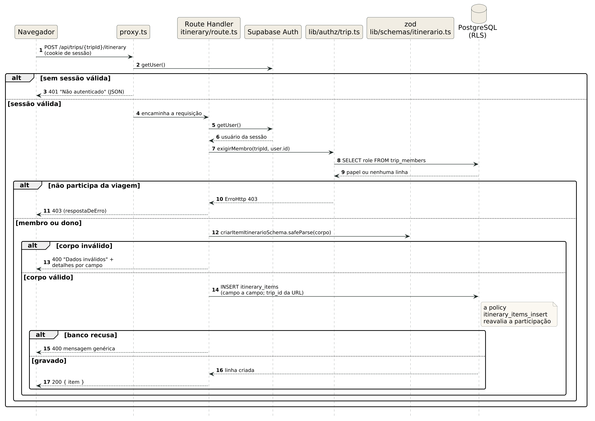
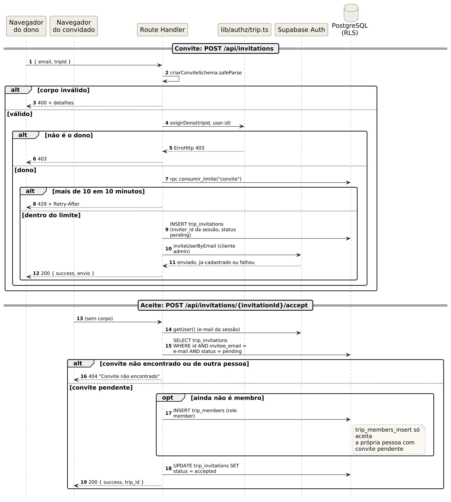
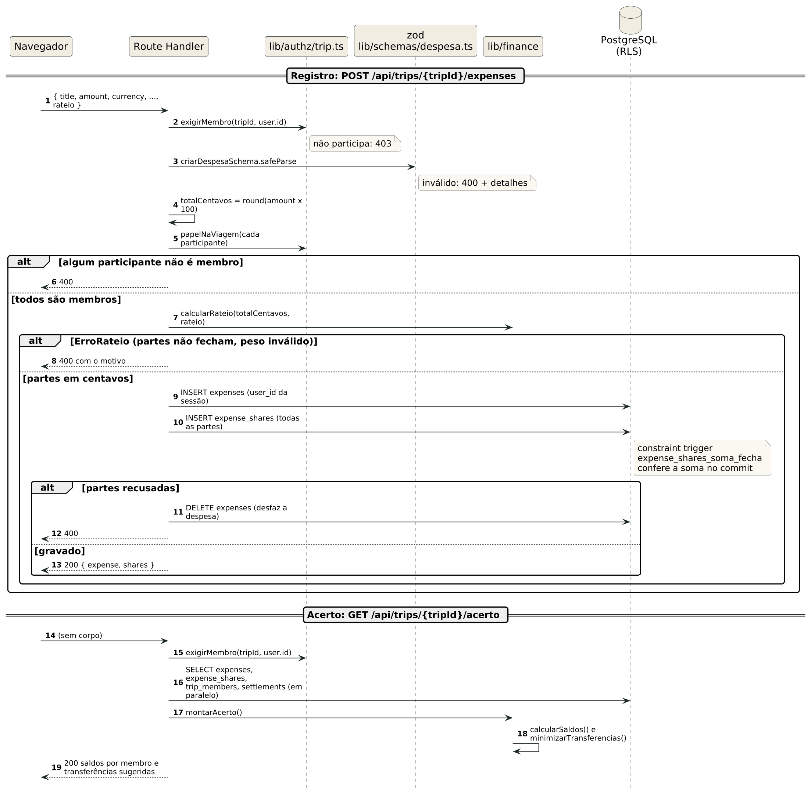
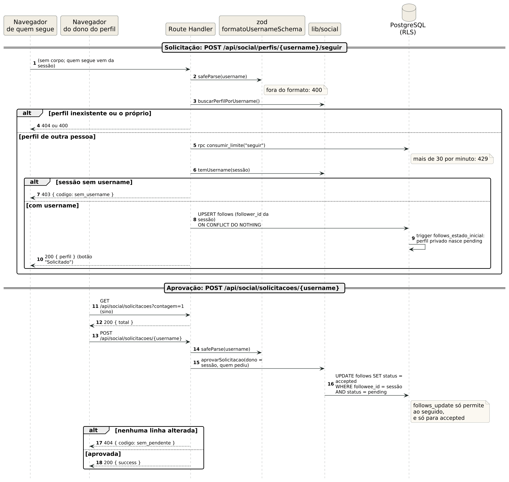
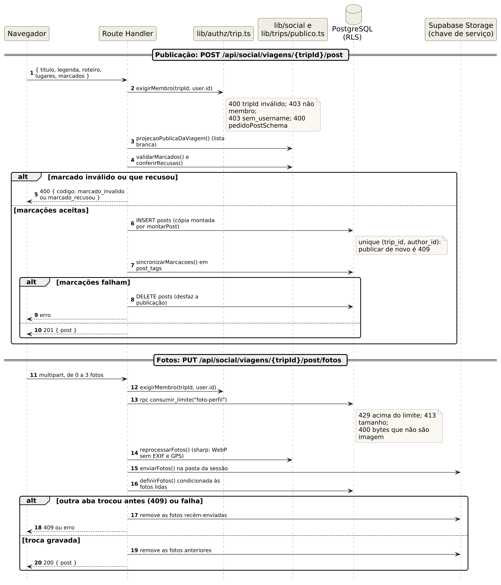

## 22 Implementação por Camadas do Sistema

Esta seção descreve como cada camada foi efetivamente implementada na versão avaliada, a da branch `main`. Tratamos primeiro a interface, depois o servidor, com o catálogo das 41 rotas e os diagramas de sequência dos padrões que elas seguem, e por fim o caminho completo do usuário até o dado. Desde 13/11/2026 a interface exibe o nome Avori, identidade visual do produto; o projeto continua sendo o Viaja Mais.

### 22.1 Frontend

A interface usa Next.js 16 com o App Router, sobre React 19 e TypeScript. No App Router cada pasta de `app/` é um endereço, e o arquivo `page.tsx` define a tela; a árvore de diretórios é, portanto, o mapa de navegação. A estilização usa Tailwind CSS 4, e os componentes básicos vêm do shadcn/ui, construído sobre os primitivos acessíveis do Radix.

#### Organização das telas

As telas se dividem em uma área pública, com a página inicial e a autenticação em `app/auth/`, e uma área autenticada, formada por `app/dashboard/` e pelo grupo de rotas `app/(rede-social)/`. O grupo não altera endereços: ele apenas reaproveita o layout do painel para o feed, a pesquisa, as notificações e o perfil de outras pessoas.

| Área | Telas | Requisitos |
|---|---|---|
| Autenticação | `/auth/login`, `/auth/sign-up`, `/auth/sign-up-success`, `/auth/reset-password` | RF01.1 a RF01.3, RF01.7 |
| Painel e viagens | `/dashboard`, `/dashboard/trips`, `/dashboard/trips/criar`, `/dashboard/trips/new`, `/dashboard/trips/[id]`, `/dashboard/trips/[id]/edit` | RF03.1 a RF03.5; RF04.1, RF04.3, RF04.7 |
| Roteiro por IA | `/dashboard/trips/criar/ia` | RF12.1 a RF12.3 |
| Itinerário | `/dashboard/trips/[id]/itinerary/new`, `.../itinerary/[itemId]/edit`, `/dashboard/itinerary` | RF05.1 a RF05.4 |
| Reservas | `/dashboard/trips/[id]/bookings/new`, `.../bookings/[bookingId]/edit`, `/dashboard/bookings` | RF07.1 a RF07.7 |
| Lugares e avaliações | `/dashboard/trips/[id]/places`, `/dashboard/places` | RF08.1 a RF08.4, RF08.6; RF11.1 a RF11.3 |
| Financeiro | `/dashboard/trips/[id]/expenses/new`, `.../expenses/[expenseId]/edit`, `/dashboard/trips/[id]/acerto`, `/dashboard/finances` | RF06.1 a RF06.3, RF06.5, RF06.9 a RF06.13 |
| Perfil e conta | `/dashboard/perfil`, `/dashboard/perfil/editar`, `/dashboard/settings` | RF01.8; RF02.1, RF02.2, RF02.5 a RF02.7 |
| Rede social | `/u/[username]`, `/u/[username]/seguidores`, `/u/[username]/seguindo`, `/pesquisar`, `/notificacoes`, `/feed/[postId]` | RF02.8; RF09.1 a RF09.7, RF09.9, RF09.10, RF09.12 a RF09.17; RF13.2, RF13.4 |
| Prévias visuais | `/feed`, `/dashboard/reservar/voos`, `/dashboard/reservar/hoteis` | nenhum requisito atendido |

A tela central é o detalhe da viagem, que reúne capa, resumo, membros e as abas Itinerário, Despesas, Lugares e Reservas. As ações de concluir, reabrir e excluir atividade, excluir reserva e marcar lugar como visitado não têm tela própria: ficam nos componentes de lista de cada aba (`itinerary-list.tsx`, `booking-list.tsx`, `place-list.tsx`). O botão de publicar a viagem na rede social também fica nessa tela.

#### Estrutura do código da interface

- `app/`: páginas, layouts e os arquivos de estado `loading.tsx`, `error.tsx` e `not-found.tsx`.
- `components/`: componentes de domínio, como listas, convites, rateio e acerto; `components/social/` reúne os da rede social.
- `components/ui/`: componentes de prateleira do shadcn/ui, sem alteração, com uma exceção nossa, `confirm-modal.tsx`.
- `components/prototipo/`: o código das telas de prévia, isolado do restante.
- `context/auth-context.tsx`: mantém no cliente a sessão, o perfil e a lista de viagens, obtida por `fetch` às rotas de API.
- `hooks/`: `use-toast.ts` e `use-mobile.ts`.

Adotamos Server Components nas telas de leitura agregada, como o detalhe da viagem, a agenda, as finanças, os lugares e as reservas. Elas consultam o banco no servidor, com a sessão do usuário, e entregam o HTML já preenchido. Formulários e telas de interação contínua são Client Components, marcados com `"use client"`, porque dependem de estado local e de eventos do usuário.

#### Navegação

O layout de `app/dashboard/layout.tsx` é compartilhado por toda a área autenticada. No computador, uma barra superior traz as seções Painel, Feed, Viagens, Agenda, Finanças, Reservas e Lugares, a pesquisa, o sino de notificações, o botão Nova viagem e o menu do usuário. No celular, uma barra de abas fixa no rodapé oferece Início, Pesquisar, Nova viagem, Viagens e Perfil, e as demais seções passam ao menu do avatar.

#### Erro, carregamento e retorno ao usuário

- Carregamento: `loading.tsx` no painel e na rede social mostra um indicador enquanto o Server Component consulta o banco.
- Erro inesperado: `error.tsx` e `global-error.tsx` exibem o componente `estado-erro.tsx`, sem expor a mensagem técnica.
- Recurso inexistente: `not-found.tsx` exibe a mesma página para viagem inexistente e para viagem de outra pessoa, o que `e2e/estados-erro.spec.ts` verifica.
- Validação: quando a rota devolve 400, as telas mostram em um aviso a mensagem do campo recusado, a mesma que o servidor aplicou.
- Ações destrutivas: pedem confirmação no `ConfirmModal`, e não nas caixas `confirm()` do navegador.

#### Acessibilidade e responsividade

O teste `e2e/acessibilidade.spec.ts` passa as telas principais pelo axe-core com as regras WCAG 2.1 níveis A e AA, nos perfis de computador e de celular, e falha listando cada violação. Ele cobre o que é verificável por máquina, como contraste, nome acessível e rótulo de campo. Foco visível e navegação por teclado dependem de roteiro manual, que não automatizamos.

#### O que é apenas prévia

Três telas têm o desenho final, mas funcionam com dados de exemplo e não gravam nada: o feed e a compra de voos e de hotéis. Cada uma exibe o selo "Prévia com dados de exemplo". Não existe integração com fornecedor de passagens no código, e o feed (RF09.8) continua não iniciado na seção 14.

### 22.2 Backend

O servidor é formado por 41 route handlers em `app/api/**`, com 69 operações HTTP no total. Route handler é o arquivo `route.ts` que o Next.js expõe como endpoint e que exporta uma função por método. Não há servidor separado: as rotas rodam no mesmo projeto Next.js, publicado na Vercel, e falam com o Supabase.

#### Padrão único das rotas

Toda rota de escrita segue o molde declarado em `app/api/trips/[tripId]/route.ts`, nesta ordem:

1. Sessão: `supabase.auth.getUser()` valida o token no servidor de autenticação; sem usuário, 401. O `proxy.ts` já devolve 401 antes, mas a rota repete a verificação.
2. Autorização: em recurso de viagem, `exigirMembro()` ou `exigirDono()` de `lib/authz/trip.ts`; na rede social, a regra do domínio (só o próprio perfil, só a autora, ou a função `pode_ver_rede`).
3. Limite de requisições: nas rotas de convite, troca de senha, seguir, foto de perfil, criação de post, fotos do post e geração de roteiro, `exigirLimite()` conta a chamada no banco e devolve 429 com `Retry-After`.
4. Validação: o corpo passa por um esquema zod de `lib/schemas/`; se falhar, 400 com o detalhe por campo.
5. Escrita campo a campo: os campos saem um a um do resultado validado; `trip_id` vem da URL já autorizada e `user_id` vem da sessão.
6. Resposta: sucesso com o registro gravado; qualquer exceção passa por `respostaDeErro()`.

Quando o identificador da viagem chega no corpo, como no convite, a validação vem antes da autorização, porque não há o que autorizar sem saber qual é a viagem. O limite vem sempre depois da autorização e antes da escrita, para que só conte a tentativa que de fato produziria efeito. Na criação de post ele vem também antes de ler o corpo, para que o servidor não processe fotos de quem já esgotou a janela.

A geração de roteiro não grava nada, e nela o limite vem depois da validação, para que um pedido inválido não gaste uma das dez gerações da hora.

#### Contrato de erro

O módulo `lib/http.ts` define a classe `ErroHttp`, que carrega o código HTTP. As verificações lançam o erro e `respostaDeErro()` o converte em resposta. Qualquer erro desconhecido vira 500 com a mensagem "Erro interno do servidor" e um código curto no cabeçalho `X-Codigo-Erro`, registrado no log. A mensagem original do Postgres nunca chega ao cliente, porque pode revelar nome de coluna, restrição ou dado de outro usuário.

| Código | Quando ocorre |
|---|---|
| 400 | corpo inválido no zod, identificador fora do formato, regra de negócio recusada (rateio que não fecha) |
| 401 | sem sessão válida |
| 403 | não participa da viagem, não é o dono, não é a autora, sem username |
| 404 | recurso inexistente ou invisível para a sessão (convite de outra pessoa, post fechado) |
| 409 | conflito: username repetido, viagem já publicada, parte de despesa já quitada, fotos alteradas em outra aba |
| 413 | arquivo acima do tamanho permitido |
| 422 | pagamento do acerto incompatível com o saldo atual |
| 429 | limite de requisições excedido |
| 500 | falha inesperada, sempre com mensagem genérica |

As rotas de post usam ainda `lib/social/post-http.ts`, que acrescenta um campo `codigo` estável ao erro, como `sem_username` ou `marcado_recusou`, para a tela decidir o que mostrar. Essas respostas saem sempre com `Cache-Control: private, no-store`, porque carregam links assinados de foto.

#### Catálogo das rotas

As tabelas a seguir listam as 41 rotas por domínio. A coluna Figura indica o diagrama de sequência que descreve o padrão da rota. Todas, exceto a de recusar convite, têm teste de integração em `tests/api/` ou `tests/lib/`.

**Tabela 22.1 — Autenticação e convites**

| Rota | Métodos | Autorização | Validação | Requisitos | Figura |
|---|---|---|---|---|---|
| `/api/auth/change-password` | POST | sessão; limite de 5 em 15 min | manual e `problemaDeSenha()` | RF01.8, RNF02.8 | — |
| `/api/invitations` | GET, POST | GET: sessão; POST: `exigirDono`, limite de 10 em 10 min | `criarConviteSchema` | RF04.1, RF04.2, RNF02.8 | 22.2 |
| `/api/invitations/[invitationId]/accept` | POST | convite pendente para o e-mail da sessão | filtro por e-mail | RF04.3 | 22.2 |
| `/api/invitations/[invitationId]/decline` | POST | e-mail da sessão | nenhuma | RF04.3 | 22.2 |

**Tabela 22.2 — Viagem, itinerário, reservas e lugares**

| Rota | Métodos | Autorização | Validação | Requisitos | Figura |
|---|---|---|---|---|---|
| `/api/trips` | GET, POST | sessão; lista por participação | `criarViagemSchema` | RF03.1, RF03.4, RNF02.5 | 22.1 |
| `/api/trips/[tripId]` | GET, PATCH, DELETE | GET: `exigirMembro`; PATCH e DELETE: `exigirDono` | `atualizarViagemSchema` | RF03.2, RF03.3, RF03.5 | 22.1 |
| `/api/trips/[tripId]/members` | DELETE | `exigirMembro`; o dono remove qualquer um, o membro só a si | `userId` obrigatório | RF04.7, RF04.8 | 22.1 |
| `/api/trips/[tripId]/itinerary` | GET, POST | `exigirMembro` | `criarItemItinerarioSchema` | RF05.1, RF05.4 | 22.1 |
| `/api/trips/[tripId]/itinerary/[itemId]` | GET, PATCH, DELETE | `exigirMembro` | `atualizarItemItinerarioSchema` | RF05.2, RF05.3 | 22.1 |
| `/api/trips/[tripId]/bookings` | GET, POST | `exigirMembro` | `criarReservaSchema` | RF07.1 a RF07.4, RF07.7 | 22.1 |
| `/api/trips/[tripId]/bookings/[bookingId]` | GET, PATCH, DELETE | `exigirMembro` | `atualizarReservaSchema` | RF07.5, RF07.6 | 22.1 |
| `/api/trips/[tripId]/places` | GET, POST | `exigirMembro` | `criarLugarSchema` | RF08.2, RF08.3 | 22.1 |
| `/api/trips/[tripId]/places/[placeId]` | PATCH, DELETE | `exigirMembro` | `atualizarLugarSchema` | RF08.4, RF08.6 | 22.1 |
| `/api/trips/[tripId]/places/[placeId]/reviews` | GET, PUT, DELETE | `exigirMembro` e lugar da viagem | `avaliacaoSchema` | RF11.1 a RF11.3 | 22.1 |

**Tabela 22.3 — Financeiro**

| Rota | Métodos | Autorização | Validação | Requisitos | Figura |
|---|---|---|---|---|---|
| `/api/trips/[tripId]/expenses` | GET, POST | `exigirMembro`; todo participante do rateio também membro | `criarDespesaSchema` | RF04.6, RF06.1, RF06.9, RF06.10 | 22.3 |
| `/api/trips/[tripId]/expenses/[expenseId]` | GET, PATCH, DELETE | `exigirMembro`; altera só quem registrou ou o dono | `atualizarDespesaSchema` | RF06.2, RF06.3 | 22.3 |
| `/api/trips/[tripId]/acerto` | GET | `exigirMembro` | `tripId` em formato UUID | RF06.11, RF06.13 | 22.3 |
| `/api/trips/[tripId]/acerto/transferencias` | POST | `exigirMembro`; pagador igual à sessão | `registrarTransferenciaSchema` | RF06.13, RNF02.9 | 22.3 |

**Tabela 22.4 — Perfil e rede social**

| Rota | Métodos | Autorização | Validação | Requisitos | Figura |
|---|---|---|---|---|---|
| `/api/profile/[userId]` | GET | sessão | UUID | RF02.1, RF02.2 | 22.4 |
| `/api/social/perfil` | GET, PATCH | só o próprio perfil | `atualizarPerfilSchema` | RF02.1, RF02.2, RF02.5 a RF02.7 | 22.4 |
| `/api/social/perfil/foto` | POST, DELETE | só o próprio perfil; limite de envios | bytes do arquivo e regeração | RF02.2 | 22.5 |
| `/api/social/perfis` | GET | sessão | `buscaPessoasSchema` | RF09.10 | 22.4 |
| `/api/social/perfis/[username]` | GET | sessão | `formatoUsernameSchema` | RF02.8 | 22.4 |
| `/api/social/perfis/[username]/seguidores` e `/seguindo` | GET | `pode_ver_rede` | `formatoUsernameSchema`, `consultaRedeSchema` | RF09.6 | 22.4 |
| `/api/social/perfis/[username]/seguir` | POST, DELETE | sessão com username; limite de 30 por minuto | `formatoUsernameSchema` | RF09.1, RF09.2, RF09.5, RF09.9 | 22.4 |
| `/api/social/perfis/[username]/posts` | GET | `pode_ver_rede` | `formatoUsernameSchema` e cursor | RF09.16 | 22.4 |
| `/api/social/perfis/[username]/marcacoes` | GET | `pode_ver_rede` | `formatoUsernameSchema` | RF09.14 | 22.4 |
| `/api/social/pesquisas` | GET, POST, DELETE | só o próprio histórico | `registrarPesquisaSchema` | RF09.12 | 22.4 |
| `/api/social/pesquisas/[username]` | DELETE | só o próprio histórico | `formatoUsernameSchema` | RF09.12 | 22.4 |
| `/api/social/pessoas` | GET | sessão | `buscaPessoasSchema` | RF09.13 | 22.4 |
| `/api/social/seguidores/[username]` | DELETE | só os próprios seguidores | `formatoUsernameSchema` | RF09.9 | 22.4 |
| `/api/social/solicitacoes` | GET | só as recebidas pela sessão | `consultaSolicitacoesSchema` | RF09.3, RF13.2 | 22.4 |
| `/api/social/solicitacoes/[username]` | POST, DELETE | só as recebidas pela sessão | `formatoUsernameSchema` | RF09.4, RF13.2 | 22.4 |
| `/api/social/marcacoes/[postId]` | DELETE | só a própria marca | UUID | RF09.14 | 22.4 |
| `/api/social/posts` | POST | sessão com username; limite de envios | `novoPostSchema` e bytes das fotos | RF09.13, RF09.15 | 22.5 |
| `/api/social/posts/[postId]` | GET, PATCH, DELETE | GET: `pode_ver_rede`; PATCH e DELETE: só a autora | `postIdSchema`, `editarPostSchema` | RF09.13, RF09.15, RF09.17 | 22.5 |
| `/api/social/viagens/[tripId]/post` | GET, POST, PATCH, DELETE | `exigirMembro` e username; DELETE só a autora | `pedidoPostSchema` | RF09.7, RF09.13 | 22.5 |
| `/api/social/viagens/[tripId]/post/fotos` | PUT | `exigirMembro`; limite de envios | bytes das fotos e regeração | RF09.7, RNF02.8 | 22.5 |

**Tabela 22.5 — Plataforma e IA**

| Rota | Métodos | Autorização | Validação | Requisitos | Figura |
|---|---|---|---|---|---|
| `/api/saude` | GET | pública | nenhuma | RNF04.1 | — |
| `/api/roteiros/gerar` | POST | sessão; limite de 10 por hora | `gerarRoteiroSchema` | RF12.1, RNF07.3, RNF07.4 | — |

Três rotas ainda fogem ao molde, e as registramos como dívida. A de recusar convite não usa `respostaDeErro` nem tem teste. A de troca de senha valida o formulário manualmente, sem zod. A de dados básicos do perfil confere o UUID por expressão regular. Nenhuma delas devolve a mensagem crua do banco.

#### Regras de negócio em `lib/`

As regras ficam em funções puras, sem acesso a banco, para que sejam testadas isoladamente e usadas tanto pela tela quanto pela rota.

- `lib/finance/rateio.ts`: divide a despesa em partes iguais, por peso ou por valor exato, sempre em centavos inteiros. A tela usa a função para a prévia e a rota recalcula com ela, sem aceitar as partes enviadas pelo navegador.
- `lib/finance/balances.ts`: `calcularSaldos()` apura quem deve a quem; `minimizarTransferencias()` casa o maior credor com o maior devedor até zerar os saldos, o que reduz o número de transferências sem garantir o mínimo absoluto.
- `lib/finance/acerto.ts`: monta o acerto por moeda, descarta partes quitadas e abate os pagamentos já registrados em `settlements`.
- `lib/finance/transferencia.ts`: confere um pagamento contra o saldo atual e recusa valor acima da dívida ou do crédito.
- `lib/finance/categorias.ts`: totaliza gastos por categoria, separados por moeda, para o gráfico das finanças.
- `lib/finance/cambio.ts`: converte valores entre moedas em centavos, com a taxa como fração inteira. O módulo tem teste, mas nenhuma tela o usa ainda.
- `lib/trips/publico.ts`: projeção pública da viagem em lista branca de colunas; orçamento, notas, coordenadas e membros nunca entram no post.
- `lib/social/foto.ts`, `imagem.ts` e `capa.ts`: conferem o tipo real do arquivo pelos primeiros bytes e regeram a imagem com o sharp em WebP, sem EXIF e sem GPS.
- `lib/seguranca/senha.ts`: exige 8 caracteres com minúscula, maiúscula, número e símbolo, a mesma regra configurada no Supabase Auth.
- `lib/seguranca/limite.ts`: define as regras de limite por usuário e libera a requisição se a contagem falhar, para que o limitador não derrube um convite legítimo.

#### Acesso a dados

O módulo `lib/supabase/` tem quatro clientes. `server.ts` cria o cliente da sessão para Server Components e rotas, com o token do usuário; toda leitura e escrita de dado da aplicação usa esse cliente, e por isso a RLS (Row Level Security, segurança por linha do PostgreSQL) se aplica. `client.ts` é usado no navegador apenas para login, cadastro, recuperação de senha e escuta da sessão. `proxy.ts` renova o cookie a cada requisição.

`admin.ts` cria o cliente com a chave de serviço, que ignora toda a RLS. Ele só é chamado dentro de route handler, e falha se for executado no navegador.

Usamos a chave em três casos: enviar o e-mail de convite pela API administrativa do Supabase Auth, que a exige; gravar, apagar ou assinar fotos nos buckets privados do Storage, que não têm política para usuário; e esvaziar `fotos_a_remover`, a fila de fotos órfãs. É a única tabela tocada com essa chave, e nenhum usuário pode lê-la ou gravá-la; o tipo do cliente em `lib/social/fila-fotos.ts` só aceita o nome dela.

Abaixo das rotas está o banco, com 22 migrations e 18 tabelas. As políticas de RLS repetem as regras das rotas: convidar exige ser dono nos dois lugares, ler dados de viagem exige participar, e `trip_members_insert` só aceita a própria pessoa com convite pendente.

Funções SQL como `is_trip_member`, `pode_ver_rede` e `consumir_limite` concentram as regras que as políticas compartilham. Gatilhos garantem invariantes que nenhuma rota pode pular, como a soma das partes de uma despesa e o estado inicial de um pedido para seguir.

#### Diagramas de sequência

Desenhamos um diagrama por padrão de rota, e não um por rota, porque as rotas de escrita seguem cinco percursos. Cada diagrama reproduz a ordem das chamadas no código da rota escolhida e mostra os desvios de erro em blocos `alt`.

A Figura 22.1 acompanha a inclusão de uma atividade no itinerário, molde de todas as rotas de viagem. O `proxy.ts` valida a sessão e devolve 401 em JSON quando ela falta. A rota repete `getUser()` e chama `exigirMembro()`, que consulta o papel do usuário em `trip_members`; sem linha, a resposta é 403.

Com a participação confirmada, o corpo passa por `criarItemItinerarioSchema` e, se inválido, volta 400 com o detalhe por campo. Só então ocorre o `INSERT`, com os campos extraídos um a um e o `trip_id` tirado da URL. A política `itinerary_items_insert` reavalia a participação no banco, como segunda linha de defesa.

Escolhemos devolver 403, e não 404, para quem não participa: separar os dois casos exigiria uma consulta extra que revelaria se a viagem existe. Reservas, lugares, avaliações e a edição da viagem seguem o mesmo percurso, trocando o esquema e, no caso da edição e da exclusão, `exigirMembro` por `exigirDono`.

A Figura 22.2 mostra os dois momentos da entrada de uma pessoa em uma viagem. No convite, a rota valida o corpo, exige que a sessão seja dona da viagem e consome o limite de 10 convites em 10 minutos. Grava o convite com `inviter_id` tirado da sessão e só depois pede ao Supabase Auth o envio do e-mail.

A ordem é deliberada: a linha em `trip_invitations` é a fonte da verdade, e uma falha no e-mail não desfaz o convite. A resposta informa se o e-mail foi enviado, se a pessoa já tinha conta ou se o envio falhou, para a tela avisar quem convidou.

No aceite, a autorização é o próprio filtro da consulta: só aparece o convite pendente endereçado ao e-mail da sessão, e qualquer outro responde 404. A inclusão em `trip_members` só passa porque a política exige convite pendente para aquele e-mail, o que impede alguém de se incluir em viagem alheia.

A Figura 22.3 mostra o registro de uma despesa dividida. Depois da autorização e do esquema, a rota converte o total para centavos e confere que todo participante do rateio é membro da viagem. A política de `expense_shares` só verifica quem grava, e sem essa conferência um membro poderia lançar dívida para qualquer conta.

O rateio é recalculado por `calcularRateio()` antes de qualquer escrita. A despesa e as partes são gravadas em dois comandos, e o gatilho `expense_shares_soma_fecha` confere no commit que a soma fecha com o total. Se as partes falharem, a rota apaga a despesa, porque as duas chamadas não formam uma transação única.

O acerto é só leitura: a rota lê despesas, partes, membros e pagamentos em paralelo e entrega a `montarAcerto()`, que calcula saldos e transferências sugeridas. O registro de pagamento usa o mesmo carregamento, de modo que o servidor confere o pedido contra o saldo que ele próprio calculou.

A Figura 22.4 representa o padrão da rede social, em que a autorização não vem de `exigirMembro`, mas da origem do identificador. Quem segue é sempre o usuário da sessão; a URL só diz quem será seguido. A rota valida o username, recusa o próprio perfil, aplica o limite de 30 por minuto e exige que a sessão tenha username.

O `UPSERT` em `follows` não informa o estado: o gatilho `follows_estado_inicial` decide que um perfil privado gera vínculo pendente. Repetir o pedido não duplica a linha, por causa do `ON CONFLICT DO NOTHING`.

Do outro lado, o sino consulta só a contagem de solicitações. A aprovação atualiza o vínculo filtrando pelo seguido igual à sessão, e a política `follows_update` só permite essa alteração ao seguido e só para o estado aceito. Sem linha alterada, a resposta é 404 com código estável, para a tela recarregar a lista.

A Figura 22.5 mostra a publicação de uma viagem, que cruza dois domínios. A rota de publicação não lê `trips` nem `itinerary_items`: usa a projeção pública de `lib/trips/publico.ts`, mantida pelo domínio de Viagem. As marcações são validadas antes de gravar, para que um marcado inválido não deixe post publicado pela metade.

O post é uma cópia montada no servidor. Se as marcações falharem depois do `INSERT`, a rota apaga o post, para que a nova tentativa não esbarre no 409 de viagem já publicada.

As fotos entram por uma segunda rota, depois do limite de envios e das verificações de tamanho e de conteúdo. O arquivo recebido nunca é gravado: a rota regera cada foto com o sharp, envia com a chave de serviço à pasta da sessão e só então troca as fotos do post. Se outra aba trocou antes, a resposta é 409 e as fotos recém-enviadas são apagadas. A criação de post sem viagem e a foto de perfil seguem o mesmo percurso.

### 22.3 Integração

Esta subseção descreve o caminho completo de uma operação, da ação do usuário ao dado gravado, e como provamos que as camadas funcionam em conjunto.

#### Leitura e escrita por caminhos diferentes

A leitura e a escrita seguem caminhos distintos. As telas de leitura agregada são Server Components que consultam o banco no servidor com o cliente da sessão, de modo que a consulta nunca é montada no navegador. Toda escrita parte de um Client Component, que chama uma rota de `app/api/**` com `fetch`.

O navegador não lê nem grava tabelas diretamente: o cliente Supabase do navegador só é usado para operações de autenticação. O teste `e2e/marcacoes.spec.ts` confere, por exemplo, que remover uma marcação passa só pela rota, sem chamada ao endpoint REST do Supabase.

#### Como a sessão viaja

O Supabase Auth guarda a sessão em cookies. A cada requisição, o `proxy.ts` (nome que o Next.js 16 deu ao antigo middleware) renova o cookie por `updateSession()`, valida o usuário com `getUser()` e aplica a política de segurança de conteúdo. Sem sessão, páginas são redirecionadas ao login e rotas de API recebem 401 em JSON. Dentro da rota ou do Server Component, `lib/supabase/server.ts` lê o mesmo cookie, e a RLS enxerga o mesmo usuário.

#### Atualização da tela e erro ponta a ponta

Depois de uma escrita bem-sucedida, os componentes chamam `router.refresh()`, que pede de novo os dados ao Server Component da página. Evitamos assim manter no cliente uma cópia do estado que poderia divergir do banco. Enquanto a requisição está em andamento, os botões do item ficam desabilitados, o que impede envio duplicado.

O erro percorre o caminho inverso com o mesmo contrato. A rota converte qualquer falha em código HTTP e mensagem em português; a tela lê o campo `error` ou o detalhe do zod e o mostra em um aviso. Na rede social, o campo `codigo` orienta a reação: `sem_username` leva a escolher um nome, e sessão vencida oferece entrar de novo.

#### Fluxos verificados de ponta a ponta

| Fluxo | Tela | Rotas | Tabelas | Teste E2E que prova |
|---|---|---|---|---|
| Criar viagem, convidar e aceitar | `/dashboard/trips/new`, detalhe da viagem, `/dashboard` | `/api/trips`, `/api/invitations`, `.../accept` | `trips`, `trip_members`, `trip_invitations` | `grupo-convite.spec.ts` |
| Montar o itinerário | `.../itinerary/new`, aba Itinerário | `/api/trips/[tripId]/itinerary`, `.../[itemId]` | `itinerary_items` | `adicionar-atividade.spec.ts`, `itinerario-crud.spec.ts` |
| Registrar reserva | `.../bookings/new`, aba Reservas | `/api/trips/[tripId]/bookings`, `.../[bookingId]` | `bookings` | `reservas.spec.ts` |
| Salvar e avaliar lugar | `/dashboard/trips/[id]/places` | `.../places`, `.../[placeId]`, `.../reviews` | `places`, `place_reviews` | `lugares.spec.ts`, `avaliacoes.spec.ts` |
| Despesa com rateio | `.../expenses/new` | `/api/trips/[tripId]/expenses` | `expenses`, `expense_shares` | `rateio-despesa.spec.ts` |
| Acerto e pagamento | `/dashboard/trips/[id]/acerto` | `.../acerto`, `.../acerto/transferencias` | `settlements`, `expense_shares` | `acerto-contas.spec.ts`, `acerto-transferencias.spec.ts` |
| Seguir e aprovar | `/u/[username]`, `/notificacoes` | `.../seguir`, `/api/social/solicitacoes` | `follows` | `seguir.spec.ts`, `solicitacoes.spec.ts` |
| Foto de perfil | `/dashboard/perfil/editar` | `/api/social/perfil/foto` | `profiles` e Storage | `foto-perfil.spec.ts` |
| Criar post com fotos | `/feed`, `/feed/[postId]` | `/api/social/posts`, `.../posts/[postId]` | `posts`, `post_tags` e Storage | `posts.spec.ts` |
| Montar viagem com a Avori | `/dashboard/trips/criar/ia` | `/api/roteiros/gerar`, `/api/trips`, `.../itinerary` | `trips`, `trip_members`, `itinerary_items` | `roteiro-ia.spec.ts` |
| Publicar viagem | detalhe da viagem | `/api/social/viagens/[tripId]/post` | `posts`, `post_tags` | `marcacoes.spec.ts` (pela API) e `jornada-completa.spec.ts` (até o diálogo) |

A última linha tem cobertura parcial: a publicação é exercitada pela API, e o teste de interface só chega até a abertura do diálogo de publicar. Os testes de rota da seção 24 completam a prova com os caminhos 200, 401, 403 e 400, e os testes de RLS autenticam dois usuários reais para provar que um não alcança os dados do outro.

O fluxo da Avori roda com o gerador determinístico: o teste prova a revisão e a criação da viagem, e o provedor real fica fora da esteira, que não tem a chave.

A seção 20.5 descreve como esse caminho muda quando o servidor for separado da aplicação Next.js; na versão avaliada, telas e rotas são publicadas juntas na Vercel.
