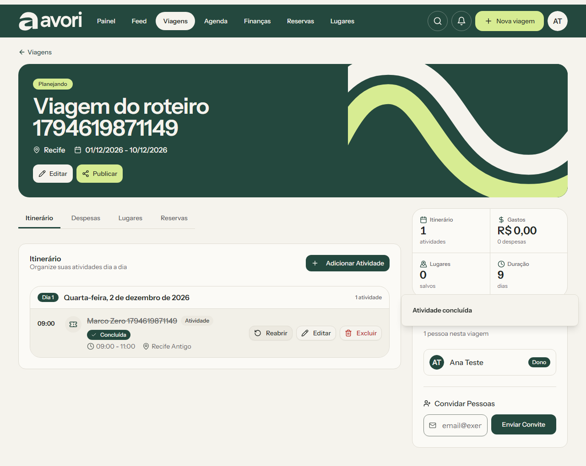
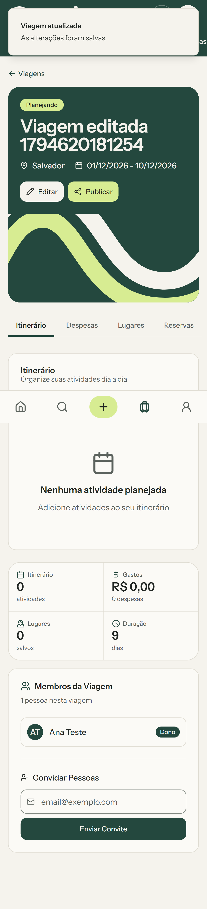

## 22. Implementação por Camadas do Sistema

Esta seção descreve como cada camada da Avori (nome adotado em novembro de 2026; até então, ViajaMais) foi efetivamente implementada, com referência aos arquivos do repositório e aos requisitos que cada parte atende.

### 22.1 Frontend

A interface foi desenvolvida em Next.js 16 com o App Router, sobre React 19. No App Router, cada rota corresponde a uma pasta dentro de `app/`, e o arquivo `page.tsx` da pasta define a tela; assim, a estrutura de diretórios é o próprio mapa de navegação do sistema. A estilização usa Tailwind CSS 4, e os componentes básicos (botões, cartões, campos, diálogos) vêm da biblioteca shadcn/ui, construída sobre os primitivos acessíveis do Radix e mantida sem alterações em `components/ui/`. Separamos a aplicação em duas áreas: a pública, com a página inicial e as telas de autenticação em `app/auth/`, e a autenticada, sob `app/dashboard/`. O acesso à área autenticada é barrado para visitantes sem sessão por `proxy.ts`, que redireciona para o login; um teste ponta a ponta de fumaça (`e2e/00-fumaca.spec.ts`) verifica esse bloqueio.

#### Organização das telas

Todas as telas da área autenticada compartilham o layout definido em `app/dashboard/layout.tsx`. No computador, uma barra superior reúne a assinatura da marca, as seções Painel, Feed, Viagens, Agenda, Finanças, Reservas e Lugares, a pesquisa de pessoas, o sino de notificações, o botão Nova viagem e o menu do usuário com Meu perfil, Configurações e Sair. No celular, uma barra de abas fixa no rodapé dá acesso a Início, Pesquisar, Nova viagem, Viagens e Perfil, e as seções que não têm aba própria (Painel, Agenda, Finanças, Reservas e Lugares) passam para o menu do usuário, aberto pelo avatar. A tela central do sistema é o detalhe da viagem, que reúne a capa, o resumo, os membros, os convites e as abas Itinerário, Despesas, Lugares e Reservas. A tabela a seguir relaciona cada tela ao tipo de componente adotado e aos requisitos do catálogo da seção 14 que ela atende.

| Tela (rota) | Tipo | Requisitos atendidos |
|---|---|---|
| `/auth/sign-up`, `/auth/sign-up-success` | Cliente | RF01.1, RF01.2 |
| `/auth/login` | Cliente | RF01.3 |
| `/auth/reset-password` | Cliente | RF01.7 |
| `/dashboard/settings` | Cliente | RF01.8, RF02.2, RF02.3 |
| `/dashboard/perfil` | Cliente | RF02.1, RF02.2, RF02.5 a RF02.7 |
| `/u/[username]`, `/u/[username]/seguidores`, `/u/[username]/seguindo` | Cliente / Servidor | RF02.8; RF09.1, RF09.2, RF09.5, RF09.6, RF09.9 |
| `/pesquisar` | Servidor | RF09.10, RF09.12 |
| `/notificacoes` | Servidor | RF13.2, RF13.4 |
| `/dashboard` | Cliente | RF03.4 (visão geral das viagens) |
| `/dashboard/trips` | Cliente | RF03.4 |
| `/dashboard/trips/criar` | Servidor | RF03.1 (escolha entre criar com a Avori e criar manualmente) |
| `/dashboard/trips/new` | Cliente | RF03.1 |
| `/dashboard/trips/criar/ia` | Cliente | RF12 (prévia visual, sem geração de roteiro) |
| `/dashboard/trips/[id]` | Servidor | RF03.5; RF04.1, RF04.3, RF04.7, RF04.8 (componentes de membros e convites); RF05.4 (aba Itinerário) |
| `/dashboard/trips/[id]/edit` | Cliente | RF03.2 |
| `/dashboard/trips/[id]/itinerary/new` | Cliente | RF05.1 |
| `/dashboard/trips/[id]/itinerary/[itemId]/edit` | Cliente | RF05.2 |
| `/dashboard/itinerary` | Servidor | RF05.4 |
| `/dashboard/trips/[id]/expenses/new`, `/dashboard/trips/[id]/expenses/[expenseId]/edit` | Cliente | RF06.1, RF06.2 |
| `/dashboard/trips/[id]/acerto` | Cliente | RF06 (acerto de contas entre os membros) |
| `/dashboard/finances` | Servidor | RF06.4, RF06.5 |
| `/dashboard/bookings` | Servidor | RF07.7 |
| `/dashboard/trips/[id]/bookings/new` | Cliente | RF07.1 a RF07.4 |
| `/dashboard/trips/[id]/bookings/[bookingId]/edit` | Cliente | RF07.5 |
| `/dashboard/places`, `/dashboard/trips/[id]/places` | Servidor / Cliente | RF08; RF11.1 a RF11.3 (avaliações, no componente `place-reviews.tsx`) |
| `/feed` | Servidor | RF10 (prévia visual, com dados de exemplo) |
| `/dashboard/reservar/voos`, `/dashboard/reservar/hoteis` | Cliente | Prévia visual de compra de passagens e hospedagem, sem requisito no catálogo |

As telas marcadas como prévia visual já têm o desenho final, mas funcionam com dados de exemplo e não gravam nada; cada uma exibe na própria tela o selo "Prévia com dados de exemplo", para que nenhum usuário ou avaliador as confunda com funcionalidades prontas. O código delas fica isolado em `components/prototipo/`, de modo que a implementação real substitui os dados de exemplo sem alterar o restante da interface.

As ações de concluir, reabrir e excluir atividade (RF05.2 e RF05.3) não têm tela própria: ficam no componente `components/itinerary-list.tsx`, exibido na aba Itinerário do detalhe da viagem. Da mesma forma, a exclusão de reserva (RF07.6) fica em `components/booking-list.tsx`, na aba Reservas, que é também o ponto de entrada para criar e editar reservas. As telas de reserva, ao salvar, retornam ao detalhe com o parâmetro `?aba=reservas`, que abre a página diretamente nessa aba para que o usuário veja o registro que acabou de gravar. Marcar um lugar como visitado e excluí-lo (RF08.4 e RF08.6) segue o mesmo desenho: as ações ficam em `components/place-list.tsx`, exibido tanto na aba Lugares do detalhe da viagem quanto na tela de lugares da viagem, e o estado de visitado é gravado pela rota de API, de modo que persiste ao recarregar a página e é visto por todos os membros do grupo.

#### Estrutura do código da interface

O código da interface está distribuído em cinco pastas. Em `app/` ficam as rotas e os layouts; em `components/` ficam os componentes interativos reutilizados entre telas, como `itinerary-list.tsx`, `trip-members.tsx`, `trip-invitations.tsx` e `place-autocomplete.tsx`, este último responsável pelo preenchimento automático de destino com o Google Places na criação de viagem; em `components/ui/` ficam os componentes de prateleira, com uma única exceção nossa, `confirm-modal.tsx`; em `context/` fica `auth-context.tsx`, que mantém no cliente a sessão do usuário e a lista de viagens; e em `hooks/` ficam os hooks compartilhados, entre eles `use-toast.ts`, usado para as mensagens de retorno ao usuário.

Adotamos a divisão entre Server Components e Client Components do React conforme a natureza da tela. As páginas de leitura agregada, como o detalhe da viagem, o itinerário geral, as finanças, os lugares e as reservas, são Server Components assíncronos: consultam o banco no servidor e entregam o HTML já preenchido, sem expor consultas ao navegador e sem uma etapa de carregamento no cliente. Formulários e telas com interação contínua, como login, cadastro, criação e edição de viagem e de atividade, despesa e configurações, são Client Components, marcados com a diretiva `"use client"`, porque dependem de estado local e de eventos do usuário. A visão geral (`/dashboard`) e a lista de viagens (`/dashboard/trips`) também são Client Components, pois leem a lista de viagens mantida em `auth-context.tsx`, que a obtém pela rota de API de viagens.

#### Comunicação com o backend e retorno ao usuário

A regra do projeto é que nenhuma escrita no banco parte do navegador. A tela envia a requisição por `fetch` a um route handler em `app/api/**`, que verifica a sessão, confirma a participação ou a propriedade da viagem por meio de `exigirMembro` e `exigirDono` (`lib/authz/trip.ts`) e valida o corpo com zod antes de gravar. Seguem esse padrão a edição de viagem (PATCH `/api/trips/[tripId]`), a criação e a listagem de viagens, a inclusão de atividade (POST `/api/trips/[tripId]/itinerary`), a edição, conclusão e exclusão de atividade (PATCH e DELETE `/api/trips/[tripId]/itinerary/[itemId]`), a inclusão, edição e exclusão de reserva (`/api/trips/[tripId]/bookings` e `.../bookings/[bookingId]`), a inclusão de despesa, a gestão de membros e convites e as configurações de perfil e senha. Com isso, a autorização não depende do código que roda no cliente, que pode ser alterado por quem o executa.

Quando o servidor rejeita os dados, as telas de viagem, de itinerário e de reserva exibem em um toast a mensagem de validação devolvida pela rota (campo `detalhes.fieldErrors` do zod), de modo que o usuário vê o mesmo motivo que o servidor aplicou. Ações destrutivas pedem confirmação no `ConfirmModal`, e não nas caixas `alert()` e `confirm()` do navegador, que não seguem a identidade visual e não podem ser testadas de forma uniforme.

No itinerário, `itinerary-list.tsx` agrupa as atividades por data e oferece por item as ações Concluir ou Reabrir, Editar e Excluir. Enquanto a requisição de um item está em andamento, os botões desse item ficam desabilitados, o que impede envios duplicados. Após cada ação, `router.refresh()` solicita novamente os dados ao Server Component da página, evitando manter no cliente uma cópia paralela do estado que poderia divergir do banco.

As reservas seguem o mesmo desenho em `booking-list.tsx`, com uma particularidade: a data e a hora de uma reserva são exibidas a partir do texto gravado, sem conversão pelo fuso horário do navegador. A hora informada é a hora local do voo ou da entrada no hotel, e convertê-la deslocaria o horário para quem consulta de outro fuso; o teste ponta a ponta `e2e/reservas.spec.ts` confere que o horário exibido é exatamente o digitado.

*Figura 22.1 — Aba Itinerário do detalhe da viagem após a conclusão de uma atividade, capturada pelo teste `e2e/itinerario-crud.spec.ts` no perfil de computador.* As atividades aparecem agrupadas em um cartão por dia, com o selo "Dia 1", a data por extenso e a contagem de atividades; cada linha traz o horário à esquerda, o ícone da categoria, o título e o local. A atividade concluída aparece com o título riscado, a linha em fundo destacado e o selo "Concluída". À direita, a coluna de resumo mostra os indicadores da viagem e os membros. Os botões Reabrir, Editar e Excluir permanecem visíveis na linha, o que mostra que a conclusão é reversível e não remove o item.

#### Responsividade e verificação

Abaixo do ponto de quebra `lg` do Tailwind, as seções da barra superior sem aba própria passam para o menu do usuário e a barra de abas aparece no rodapé, com espaço reservado no fim do conteúdo para que ela não cubra o último elemento da página; os cabeçalhos de página e os cartões são empilhados em telas estreitas. A verificação da interface é feita por testes ponta a ponta em Playwright, executados em dois perfis definidos em `playwright.config.ts`: `chromium`, que simula um navegador de computador, e `mobile`, que simula um Pixel 7. O perfil de celular já revelou um defeito real: a antiga barra lateral sobrepunha o conteúdo e cobria o botão de salvar, o que levou à correção do layout do painel registrada na versão 2.6 da Parte 00.

*Figura 22.2 — Detalhe da viagem logo após a edição, capturado pelo teste `e2e/editar-viagem.spec.ts` no perfil `mobile`.* A imagem mostra o cabeçalho da viagem com a capa, o status, o título, o destino, as datas e os botões Editar e Publicar empilhados na largura do celular, sem rolagem lateral; logo abaixo vêm as abas e o itinerário, e só depois o resumo e os membros. No topo, o aviso "Viagem atualizada" confirma a gravação. A barra de abas aparece no meio da imagem por efeito da captura de página inteira; no aparelho, ela fica presa ao rodapé. Para chegar a essa tela, o teste precisou preencher e salvar o formulário de edição no mesmo perfil, etapa que antes da correção falhava porque o botão de salvar ficava encoberto.

#### Limitações conhecidas

Todas as telas da área autenticada passaram a gravar pelas rotas de API. A última exceção era a de lugares da viagem (`app/dashboard/trips/[id]/places/page.tsx`), que inseria e excluía registros em `places` diretamente do navegador com o cliente Supabase, de modo que a proteção dependia apenas da RLS do banco. Ela agora lê e grava pelas rotas `/api/trips/[tripId]/places` e `/api/trips/[tripId]/places/[placeId]`, que verificam a participação na viagem antes de qualquer operação. Permanece como limitação a busca de lugares, que depende da chave do Google Maps e por isso não é exercitada pelos testes automatizados, que criam o lugar de partida diretamente pela rota de API.

### 22.2 Backend

O backend da Avori não é um serviço separado: é formado pelos route handlers do Next.js em `app/api/**`, executados no servidor, pelas bibliotecas de regras de negócio em `lib/` e pelo banco PostgreSQL do Supabase, cujo schema, funções e políticas de Row Level Security (RLS) estão versionados em `supabase/migrations/`. Cada rota é um arquivo `route.ts` que exporta uma função por método HTTP (`GET`, `POST`, `PATCH`, `DELETE`); nesta versão do Next.js, os parâmetros dinâmicos da URL chegam como `Promise` e são lidos com `await params`. O repositório tem hoje 39 arquivos de rota, organizados por domínio.

| Grupo de rotas | Responsabilidade | Requisitos |
|---|---|---|
| `app/api/trips/` e `app/api/trips/[tripId]/` | Criação, listagem, edição e exclusão de viagem | RF03 |
| `.../[tripId]/members`, `app/api/invitations/**` | Convite, aceite, recusa, remoção e saída de membro | RF04 |
| `.../[tripId]/itinerary/**`, `.../bookings/**`, `.../places/**` | Itinerário, reservas e lugares da viagem | RF05, RF07, RF08 |
| `.../[tripId]/places/[placeId]/reviews` | Avaliações de lugares | RF11 |
| `.../[tripId]/expenses/**`, `.../[tripId]/acerto/**` | Despesas, rateio, acerto de contas e registro de pagamento | RF06 |
| `app/api/social/**`, `app/api/profile/[userId]` | Perfil, seguir, solicitações, busca, histórico de pesquisa, publicações e marcações | RF02, RF09 |
| `app/api/auth/change-password` | Troca de senha com conferência da senha atual | RF01.8 |

#### Autenticação e autorização

A autenticação é feita em duas camadas. Antes de qualquer rota, `proxy.ts` e `lib/supabase/proxy.ts` renovam a sessão a partir do cookie e, para requisição sem sessão a um endereço de `/api`, respondem 401 em JSON. Dentro da rota, o usuário é obtido por `supabase.auth.getUser()`, que confere o token no servidor de autenticação; a ausência de usuário resulta em `naoAutenticado()`, também 401. O cliente usado pelas rotas é o de `lib/supabase/server.ts`, autenticado pelo cookie e com a chave pública do projeto, de modo que toda consulta continua sujeita à RLS do usuário da sessão.

A autorização sobre viagens está concentrada em `lib/authz/trip.ts`. A função `exigirMembro()` consulta o papel do usuário em `trip_members` e lança 403 quando ele não participa; `exigirDono()` aplica a mesma consulta e exige o papel de dono. Toda rota sob `app/api/trips/[tripId]/` chama uma das duas antes de ler ou gravar dados da viagem: `exigirDono()` protege a edição e a exclusão da viagem e o envio de convites, e `exigirMembro()` protege itinerário, reservas, lugares, avaliações, despesas e acerto. Algumas rotas acrescentam uma checagem própria depois dela. Na edição e na exclusão de despesa, `exigirAutorOuDono()` restringe a operação a quem registrou a despesa ou ao dono da viagem (RNE-011); na remoção de membro, apenas o dono remove outra pessoa e o dono não pode sair (RNE-005); no registro de pagamento do acerto, o pagador tem de ser o usuário da sessão (RNE-017).

Nem toda rota segue esse desenho, porque nem toda operação tem uma viagem de referência. A criação de viagem exige apenas sessão, e a listagem filtra por participação com uma junção interna em `trip_members`. O aceite e a recusa de convite não usam `exigirMembro()`, pois quem aceita ainda não é membro: a autorização é o filtro do convite pelo e-mail da sessão e pelo estado pendente. As rotas sociais decidem o acesso pela visibilidade do perfil e pelo vínculo de seguir, e não pela participação em viagem, com exceção da publicação de viagem (`app/api/social/viagens/[tripId]/post`), que chama `exigirMembro()`. A troca de senha, o convite, a foto de perfil, o seguir e a criação de publicação aplicam ainda limite de requisições por usuário (`lib/seguranca/limite.ts`), respondendo 429 quando ele é excedido.

#### Validação e fluxo de escrita

Toda escrita passa por uma rota de API; nenhuma tela grava diretamente no banco (RNF02.6). O fluxo de uma escrita tem a mesma ordem em todas as rotas de viagem, e o molde é `app/api/trips/[tripId]/route.ts`: obter o usuário, verificar a autorização, validar o corpo com o esquema `zod` correspondente em `lib/schemas/` e, só então, gravar. Os esquemas descrevem uma lista fechada de campos, e a rota extrai o resultado validado campo a campo antes do `insert` ou do `update`; o corpo da requisição nunca é repassado ao banco (RNF02.7). Identificadores que definem a posse do registro não vêm do cliente: `trip_id` sai da URL e `user_id` da sessão. As consultas de um item filtram pela viagem e pelo identificador ao mesmo tempo, de modo que trocar o identificador na URL não alcança registro de outra viagem.

A criação de despesa (`app/api/trips/[tripId]/expenses/route.ts`) ilustra a relação entre a rota e as regras de negócio. Depois de `exigirMembro()` e da validação por `criarDespesaSchema`, a rota confere que cada participante do rateio é membro da viagem e recalcula as partes com `calcularRateio()` (`lib/finance/rateio.ts`), descartando qualquer valor calculado pelo navegador; só depois grava a despesa e as partes. Como não há transação entre as duas gravações, a rota exclui a despesa recém-criada se a gravação das partes falhar. No banco, o gatilho `expense_shares_soma_fecha` confere, no fim da transação, que a soma das partes coincide com o valor da despesa. A regra fica, portanto, em três lugares com papéis distintos: a função pura, que calcula; a rota, que decide se a operação pode acontecer; e o banco, que recusa o estado inconsistente mesmo que uma rota falhe.

As bibliotecas de `lib/` são organizadas por domínio e, nas regras de cálculo, são funções puras, sem acesso a banco nem a rede. Em `lib/finance/`, `rateio.ts` calcula as partes, `balances.ts` calcula os saldos e as transferências sugeridas, `acerto.ts` separa o acerto por moeda, `transferencia.ts` valida um pagamento contra o saldo e `categorias.ts` monta o relatório por categoria; todas operam em centavos inteiros. Em `lib/trips/`, `publico.ts` define o recorte público de uma viagem, único ponto pelo qual o domínio social lê dados de viagem; em `lib/social/` e `lib/lugares/` ficam as regras da rede social e das avaliações. Essa separação permite testar as regras sem banco e reaproveitá-las na tela: o formulário de despesa mostra a prévia do rateio com as mesmas funções que a rota usa para recalculá-lo.

#### Fluxo de leitura

As leituras seguem dois caminhos. As telas de leitura agregada, como o detalhe da viagem e as finanças, são Server Components que consultam o banco no servidor com o cliente da sessão, sob a RLS, sem passar por rota de API (seção 22.1). Os componentes interativos e os formulários leem pelas rotas de API, como a listagem de viagens, o carregamento de uma despesa para edição e a consulta do acerto, que recalcula saldos e transferências no servidor a cada requisição. Toda consulta de listagem leva o limite de 500 registros definido em `lib/listagem.ts` (RNF06.4), com a exceção deliberada do acerto de contas e dos totais de finanças, que precisam de todas as despesas para não produzir saldo errado.

#### Acesso ao banco, migrations e RLS

O schema é integralmente reproduzível a partir de `supabase/migrations/`, cujos arquivos são nomeados por data e hora e pelo domínio, como `20260926102023_financeiro_rateio.sql` e `20261111100000_financeiro_settlements.sql`. Toda tabela da aplicação tem RLS habilitada, e as políticas expressam no banco as mesmas regras que as rotas aplicam: participação na viagem para ler, autoria ou propriedade para alterar o que é pessoal, e ausência de política para operações proibidas, como alterar ou excluir um pagamento registrado em `settlements`. As funções auxiliares das políticas, como `can_access_trip`, `pode_acessar_despesa`, `pode_editar_despesa` e `pode_ver_rede`, respondem apenas sobre o usuário da sessão (`auth.uid()`), de modo que não servem para consultar a situação de terceiros. Além das políticas, as permissões de atualização são concedidas por coluna (`20261112010000_plataforma_rls_participante.sql`), o que impede, por exemplo, trocar o pagador de uma despesa ou o autor de uma reserva mesmo por requisição direta à API do Supabase. A RLS é a segunda linha de defesa: as rotas verificam a autorização antes de consultar o banco, e as políticas garantem o isolamento caso uma verificação falhe.

A chave de serviço, que ignora a RLS, é lida apenas em `lib/supabase/admin.ts`, cuja função recusa execução no navegador. Ela é usada em route handlers para o que a RLS não resolve: o envio do convite pela API administrativa de autenticação e as operações sobre as fotos guardadas em área privada do armazenamento — envio, remoção e emissão de endereços temporários de leitura —, sempre depois de a rota decidir que a operação é permitida, além da limpeza da fila de fotos a remover (`lib/social/fila-fotos.ts`). As demais tabelas da aplicação são lidas e gravadas com o cliente da sessão.

#### Tratamento de erros

Os erros de autorização e de regra de negócio são lançados como `ErroHttp` (`lib/http.ts`), com o código adequado: 401 sem sessão, 403 sem permissão, 404 para registro inexistente ou de outra viagem, 409 para conflito de estado, como alterar o valor de uma despesa com parte quitada, 422 para pagamento que não cabe no saldo e 429 para limite de requisições excedido. A validação inválida responde 400 com os detalhes do `zod`, que as telas exibem ao usuário. Qualquer outro erro é convertido por `respostaDeErro()` em 500 com mensagem genérica, sem a mensagem original do PostgreSQL, que poderia revelar nomes de coluna ou de restrição; um código curto é registrado no log e devolvido no cabeçalho `X-Codigo-Erro`, para localizar a ocorrência sem expor detalhes ao cliente.

#### Testes do backend

As rotas são cobertas por testes de integração em `tests/api/` e, nas rotas mais antigas, em `tests/lib/` (por exemplo, `tests/lib/expenses-route.test.ts`). Eles executam o route handler real com um cliente Supabase substituído por dublês ou por um banco falso em memória (`tests/api/banco-falso.ts`) e cobrem, conforme exige o projeto, os caminhos de sucesso, ausência de sessão (401), acesso negado (403) e dados inválidos (400), além de casos próprios de cada rota, como a idempotência do registro de pagamento e a ausência de atribuição em massa. Como esses testes não exercitam o banco real, as políticas são provadas à parte pela suíte de `tests/rls/`, executada com `npm run test:rls` contra o Supabase local: cada teste usa dois usuários reais e verifica tanto a leitura quanto a escrita, pois uma consulta vazia, isoladamente, também ocorreria se o dado não existisse. Entre eles, `tests/rls/01-isolamento.test.ts` prova o isolamento entre viagens, `tests/rls/02-rateio.test.ts` e `tests/rls/07-settlements.test.ts` o dos dados financeiros e `tests/rls/13-participante.test.ts` as restrições de escrita por papel. As regras puras de `lib/` têm testes de unidade em `tests/lib/`, sob o corte de cobertura de 70% (RNF05.4). Na integração contínua, `.github/workflows/ci.yml` executa os testes de unidade e de integração, a cobertura a conferência de rastreabilidade, o build e os testes ponta a ponta, e `.github/workflows/db.yml` aplica as migrations em base limpa e executa a suíte de RLS a cada alteração do banco.
