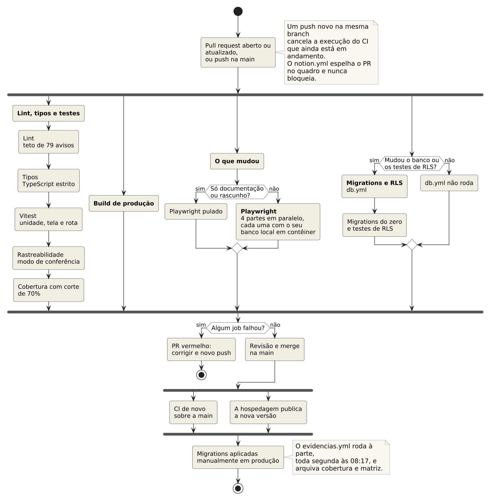
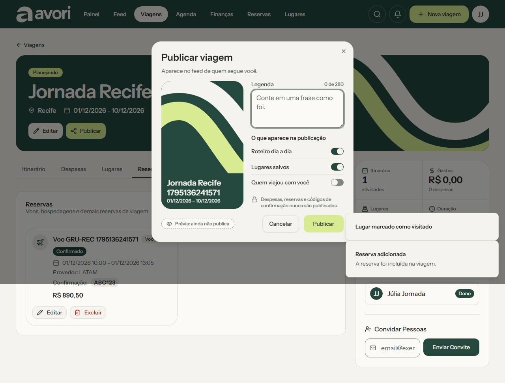

## 24 Qualidade do Software e Testes

Esta seção descreve como verificamos a qualidade do Viaja Mais: a estratégia de testes, a integração contínua que a executa, os dados da esteira e do processo, os resultados obtidos, a ligação entre testes e requisitos, os defeitos que os testes revelaram e os limites do que eles provam.

Os números se referem à `main` no commit `9651a8d`, em 22/11/2026. Os dados da esteira foram extraídos do GitHub pelo comando `npm run pfc:metricas` e estão em `docs/pfc/evidencias/2026-11-22/metricas.md`.

### 24.1 Estratégia de testes

A decisão sobre o que testar não fica a critério de quem implementa. Cada tipo de mudança tem um teste obrigatório, definido nas convenções do repositório, e o plano de cada atividade em `docs/plans/` traz os blocos "O que testar" e "O que validar" preenchidos antes da implementação. Escrever o critério antes impede que ele seja ajustado depois ao que o código já faz.

| Tipo de mudança | Teste obrigatório |
|---|---|
| Migration ou política de RLS | Aplicação do zero e teste com dois usuários provando o isolamento |
| Route handler | Integração nos caminhos 200, 401 (sem sessão), 403 (não membro) e 400 (dados inválidos) |
| Regra de negócio em `lib/` | Unidade com casos de borda, cobertura mínima de 70% |
| Tela ou componente | Ponta a ponta do fluxo, com captura de tela, escrito por quem construiu a tela |
| Correção de defeito | Regressão que falha antes da correção e passa depois |

Os tipos de teste respondem a perguntas diferentes, e nenhum substitui o outro. O teste de rota usa um cliente de banco simulado: prova a lógica de autorização e validação, mas não a consulta. Por isso as políticas de acesso são testadas à parte, contra um banco real recriado pelas migrations, com usuários autenticados de verdade.

| Tipo | Ferramenta | Onde fica | O que prova |
|---|---|---|---|
| Unidade e componente | Vitest, Testing Library | `tests/lib/`, `tests/components/`, `tests/auth/` | Regras isoladas: rateio, saldos, política de senha, limites |
| Integração de rota | Vitest, cliente simulado | `tests/api/` | Os quatro caminhos de resposta de cada rota |
| Isolamento (RLS) | Vitest contra Supabase local | `tests/rls/` | Um usuário não lê nem altera o que pertence a outro |
| Ponta a ponta | Playwright | `e2e/` | O fluxo pela interface, em computador e em celular (Pixel 7) |
| Acessibilidade | Playwright com axe-core | `e2e/acessibilidade.spec.ts` | Ausência de violações WCAG 2.1 A e AA detectáveis por máquina |
| Mutação | Sabotagem deliberada da regra | `docs/pfc/evidencias/*-mutacoes.txt` | Que a suíte percebe quando uma proteção é retirada |

No teste de mutação, retiramos de propósito uma proteção (uma política, um filtro, um cabeçalho) e conferimos que algum teste falha. Uma sabotagem que nenhum teste percebe revela uma proteção sem vigilância. Há nove registros dessas rodadas, concentrados na camada social, no armazenamento de fotos e nas avaliações de lugares.

A distribuição real da suíte em 22/11/2026 tem a forma de pirâmide: a base é rápida e larga, e o topo, caro, roda em paralelo.

| Camada | Casos | Onde roda |
|---|---|---|
| Unidade, componente e rota | 1.511, em 83 arquivos | Job "Lint, tipos e testes", 2,0 min no total |
| Isolamento e integração com banco real | 473 | Job "Migrations e RLS", 2,9 min |
| Ponta a ponta, incluindo acessibilidade | 270 aprovados e 4 pulados | 4 jobs paralelos, de 6,2 a 9,1 min cada |

### 24.2 Integração contínua

A integração contínua roda no GitHub Actions e é definida por cinco arquivos em `.github/workflows/`. Dois verificam o código (`ci.yml` e `db.yml`); dois apenas registram (`notion.yml` e `evidencias.yml`); e um vigia a produção (`disponibilidade.yml`). A Figura 24.1 mostra o caminho de uma alteração, do pull request à publicação.

O diagrama se lê de cima para baixo. As barras horizontais marcam o início e o fim de trabalhos em paralelo: os quatro ramos centrais são jobs que o GitHub executa ao mesmo tempo, em máquinas separadas. Os losangos são as decisões que fazem um job rodar ou ser pulado. Escolhemos jobs independentes porque uma falha de lint não deve esconder uma falha de build, e o relatório mostra todas de uma vez.

O que cada etapa faz:

- **Lint, tipos e testes** (`ci.yml`). Roda o ESLint com teto de 79 avisos, que é a dívida herdada e só pode cair; a checagem de tipos do TypeScript; os 1.511 testes do Vitest; e a conferência de rastreabilidade (seção 24.5). Qualquer falha deixa o job vermelho.
- **Cobertura**, no mesmo job. Mede a cobertura com corte de 70% configurado em `vitest.config.mts`; abaixo do corte, o job falha. Até 22/11/2026 o passo estava marcado com `continue-on-error` e não derrubava o job, o que corrigimos nesta versão. O relatório é arquivado por 30 dias.
- **Build de produção** (`ci.yml`). Executa `next build` com valores substitutos para as variáveis públicas. Prova que o projeto compila; o artefato não é publicado.
- **O que mudou** (`ci.yml`). Compara o PR com a base. Se só mudaram `docs/` ou arquivos `.md`, ou se o PR é rascunho, o ponta a ponta é pulado.
- **Playwright em 4 partes** (`ci.yml`). Cada parte sobe o próprio Supabase local, com as migrations e o seed aplicados do zero, gera o build contra ele e roda um quarto da suíte. Uma parte que falha não cancela as outras.
- **Migrations e RLS** (`db.yml`). Roda quando o PR altera `supabase/`, `tests/rls/` ou o próprio workflow, e no push à `main` que altera os dois primeiros. Sobe o banco do zero e executa os testes de isolamento.
- **Notion** (`notion.yml`). Espelha a abertura, a revisão e o fechamento do PR no quadro de atividades. É tolerante a falha e nunca bloqueia.
- **Disponibilidade** (`disponibilidade.yml`). Roda a cada cinco minutos, fora da esteira de PR. Consulta a página inicial e `/api/saude` em produção; a falha só conta depois de uma segunda tentativa, 20 s depois. Cada execução é uma amostra do RNF04.1.
- **Evidências** (`evidencias.yml`). Roda toda segunda-feira às 08:17 e sob demanda. Mede a cobertura, gera a matriz e roda o checklist do documento, e arquiva o resultado por 90 dias.

Duas decisões reduzem o tempo de espera. O `ci.yml` declara um grupo de concorrência por branch com cancelamento: um push novo cancela a execução ainda em andamento, que já não diz nada sobre o código atual. E a divisão do ponta a ponta em quatro partes, cada uma com o próprio banco, levou a suíte de cerca de 15 minutos em série para 6 a 9 minutos.

As versões das ferramentas são fixas. Em 10/11/2026, uma versão nova da linha de comando do Supabase passou a recusar o arquivo de configuração e derrubou o job de banco em todos os PRs, sem mudança no repositório. Desde então a versão é fixada em 2.104.0 nos dois workflows, igual à das máquinas da equipe.

A publicação não passa pela esteira. A Vercel, integrada ao repositório, gera o build e publica cada push na `main` em https://viaja-mais.online/. As migrations, porém, não são aplicadas automaticamente no banco de produção: nenhum dos quatro workflows faz isso, e a aplicação é manual. É uma limitação, tratada como risco na seção 25.

A regra de que o merge exige esteira verde é uma convenção da equipe. A proteção da branch é configurada no GitHub, fora do repositório, e por isso não a apresentamos como evidência.

### 24.3 Dados da esteira e do processo

Os dados abrangem de 26/08/2026 a 22/11/2026. A taxa de sucesso desconsidera as execuções canceladas.

| Workflow | Execuções | Sucesso | Falha | Cancelada | Taxa de sucesso | Mediana | P90 |
|---|---|---|---|---|---|---|---|
| CI | 187 | 146 | 11 | 30 | 93,0% | 95 s | 7,4 min |
| Banco de dados | 90 | 74 | 16 | 0 | 82,2% | 2,3 min | 3,0 min |
| Notion | 186 | 180 | 6 | 0 | 96,8% | 32 s | 65 s |
| Evidências | 12 | 11 | 1 | 0 | 91,7% | 36 s | 80 s |

As 30 execuções canceladas do CI são as substituídas por um push mais novo, efeito do cancelamento descrito acima. A distância entre a mediana de 95 s e o P90 de 7,4 min tem duas causas: o ponta a ponta não roda em PRs só de documentação, e, até 11/11/2026, o job de ponta a ponta terminava em cerca de 50 s sem executar teste algum (seção 24.6). O P90 representa as execuções em que o Playwright roda de fato.

O workflow de banco tem a menor taxa, 82,2%. O próprio arquivo registra duas causas de falha: a primeira migration, que quebrou o job quando ele ainda usava um PostgreSQL puro, e a mudança de versão da ferramenta em 10/11. Não conseguimos atribuir cada uma das 16 falhas a uma causa. Somam-se ao total seis execuções de automações do próprio GitHub (Copilot), que não fazem parte da esteira.

Tempo por etapa na última execução bem-sucedida na `main`:

| Workflow | Etapa | Duração |
|---|---|---|
| CI | O que mudou | 6 s |
| CI | Build de produção | 79 s |
| CI | Lint, tipos e testes | 2,0 min |
| CI | Playwright 1/4 · 2/4 · 3/4 · 4/4 | 7,5 · 6,2 · 9,1 · 7,2 min |
| Banco de dados | Migrations e RLS | 2,9 min |

O ponta a ponta domina o tempo, e a parte mais lenta define quando a esteira termina. O retorno sobre lint, tipos e os 1.511 testes chega em 2 minutos, antes de qualquer parte do Playwright terminar.

Pull requests e commits no mesmo período:

| Indicador | Valor |
|---|---|
| Pull requests abertos | 79 (72 integrados, 7 fechados sem integração) |
| Tempo entre abrir e integrar | mediana de 1,5 h; P90 de 7,2 dias |
| PRs com revisão registrada no GitHub | 19 de 79 |
| Commits na `main`, sem merges | 162 |
| Planos de atividade em `docs/plans/` | 79 |

O dado mais importante desta tabela é negativo. O fluxo da equipe prevê revisão de todo PR antes do merge, mas apenas 19 dos 79 têm revisão registrada no GitHub. Os dados não distinguem a revisão feita fora da ferramenta da revisão que não aconteceu; o que se pode afirmar é que a regra não deixou registro em 60 PRs. Com mediana de 1,5 h entre abrir e integrar, a maioria foi integrada no mesmo dia.

| Tipo de commit | Commits |
|---|---|
| feat (funcionalidade) | 59 |
| fix (correção) | 34 |
| docs (documentação) | 27 |
| chore (manutenção) | 19 |
| test (teste) | 10 |
| sem tipo, refactor, perf e revert | 13 |

| Autor | Commits na `main` |
|---|---|
| Fernando Oliveira | 73 |
| Micael Cruz Batista Martins | 58 |
| Audrey Lacerda | 15 |
| Abner Cosmo | 14 |
| Automação do GitHub | 2 |

Há uma correção para cada 1,7 funcionalidade. Os commits do tipo `test` são poucos porque a regra exige o teste no mesmo commit da funcionalidade. A contagem por autor mostra concentração em duas pessoas; ela não mede esforço, já que um commit pode ser uma linha ou uma migration inteira.

### 24.4 Tipos de teste e resultados

Resultado da execução da esteira na `main` em 22/11/2026:

| Verificação | Resultado |
|---|---|
| Lint e checagem de tipos | Sem erro |
| Vitest: unidade, componente e rota | 1.511 testes em 83 arquivos, todos aprovados |
| Cobertura sobre `lib/` e `app/api/` | 97,56% das linhas, 95,3% das instruções, 90,36% dos desvios, 96,58% das funções |
| Migrations aplicadas do zero | 21, sem erro |
| Isolamento e integração com banco real | 473 testes, todos aprovados |
| Playwright, computador e celular | 270 aprovados, 4 pulados, nenhuma falha |
| Acessibilidade (axe-core) | Incluída no Playwright, sem violação |

Depois dessa execução, a correção do risco R23 (seção 25.5) acrescentou uma migration e um teste de isolamento: na máquina de desenvolvimento, as 22 migrations aplicam do zero e os 474 testes passam.

Os quatro testes pulados são declarados no próprio código e dependem do perfil: três verificam gestos e leiautes que só existem no celular e são pulados no computador; um usa o clique do meio do mouse e é pulado no celular.

A evolução da suíte ao longo do semestre:

| Data | Marco | Vitest | RLS | Ponta a ponta | Cobertura de linhas |
|---|---|---|---|---|---|
| 13/09/2026 | Fase 01 | 61 | 19 | 5 | não medida |
| 18/10/2026 | Fase 02 | 421 | 111 | 22, só em execução local | 84,6% |
| 13/11/2026 | Coleta intermediária | 928 | 280 | 183 | 96,55% |
| 22/11/2026 | Esta entrega | 1.511 | 473 | 270 | 97,56% |

A suíte passou de 85 casos na Fase 01 para 2.254 nesta entrega. A mudança mais relevante não está no volume: até 18/10 o ponta a ponta rodava só nas máquinas da equipe, e desde 11/11 roda na esteira a cada PR com código.

O número mais importante da cobertura é o de `lib/finance/`, com 100% das linhas e 99,37% dos desvios na coleta de 13/11. Ali estão o rateio e a minimização de transferências, regras em que um erro de arredondamento cobra valor indevido de alguém. O ponto baixo são os invólucros do SDK em `lib/supabase/`, que só os testes de RLS e de ponta a ponta exercitam; preferimos deixá-los contar contra a média a excluí-los da medição.

### 24.5 Relação entre testes, requisitos e funcionalidades

A ligação é feita por marcação no código. Todo requisito implementado leva uma tag no formato `@RF03.2` em comentário, no arquivo que o implementa e no teste que o verifica. O script `scripts/pfc/rastreabilidade.mjs` cruza as tags com o catálogo das seções 14 e 15 e gera a matriz em `docs/pfc/rastreabilidade.md`.

Em 22/11/2026, o catálogo tem 140 requisitos, 78 com implementação marcada e 72 com teste marcado.

| Grupo | No catálogo | Marcados no código | Com teste |
|---|---|---|---|
| RF01 Autenticação | 8 | 2 | 2 |
| RF02 Gestão de perfil | 8 | 6 | 6 |
| RF03 Viagens | 8 | 5 | 5 |
| RF04 Viagens em grupo | 9 | 7 | 6 |
| RF05 Itinerário | 7 | 7 | 4 |
| RF06 Controle financeiro | 13 | 8 | 8 |
| RF07 Reservas | 7 | 7 | 4 |
| RF08 Lugares | 6 | 5 | 4 |
| RF09 Rede social | 17 | 15 | 15 |
| RF10 Interação social | 4 | 0 | 0 |
| RF11 Avaliações de lugares | 3 | 3 | 3 |
| RF12 IA de roteiros | 3 | 0 | 0 |
| RF13 Notificações | 4 | 2 | 1 |
| RNF01 a RNF08 | 43 | 11 | 14 |
| **Total** | **140** | **78** | **72** |

A diferença entre as duas últimas colunas mostra onde há código sem teste próprio. Exemplos: os tipos de reserva hotel, carro e atividade (RF07.2 a RF07.4), que a rota aceita, mas só o voo é testado; e a busca de lugares do Google (RF08.1), que depende de chave real. Nos não funcionais o número de testes supera o de código, porque requisitos como o RNF03.1 (uso em celular) são provados por teste sem um arquivo de implementação único.

O comando `npm run pfc:rastreabilidade:check` roda em todo PR. Ele falha quando uma tag cita requisito que não existe no catálogo. Falha também quando um requisito marcado como "Implementado" não tem teste. Até esta versão o catálogo usava o rótulo "Existente", que o script não reconhecia, e essa segunda regra não conferia nada. O catálogo passou a usar "Implementado", e os 60 requisitos com esse status têm teste marcado.

Para cada funcionalidade com tela, a ligação vai do requisito à rota e à interface. Alguns exemplos:

| Requisito | Funcionalidade | Integração de rota | Ponta a ponta |
|---|---|---|---|
| RF03.2 | Editar viagem | `tests/api/trips-patch.test.ts` | `e2e/editar-viagem.spec.ts` |
| RF05.2, RF05.3 | Editar e excluir atividade | `tests/api/itinerary-item-route.test.ts` | `e2e/itinerario-crud.spec.ts` |
| RF06.9, RF06.10 | Rateio da despesa | `tests/lib/expenses-route.test.ts` | `e2e/rateio-despesa.spec.ts` |
| RF06.13 | Acerto de contas | `tests/api/acerto-transferencias-route.test.ts` | `e2e/acerto-transferencias.spec.ts` |
| RF09.15 | Publicação com fotos | `tests/api/social-posts-criar-route.test.ts` | `e2e/posts.spec.ts` |
| RF11.1 a RF11.3 | Avaliar lugar | `tests/api/place-reviews-route.test.ts` | `e2e/avaliacoes.spec.ts` |

Além dos testes por funcionalidade, `e2e/jornada-completa.spec.ts` encadeia as telas na ordem em que uma pessoa nova as usa: cadastro, criação da viagem, atividade, lugar visitado, reserva e abertura da publicação. Os testes isolados provam cada tela; a jornada prova que elas funcionam juntas para quem não tem dado prévio.

Ao fundo está o detalhe da viagem criada pela conta recém-cadastrada, na aba Reservas, com o voo cadastrado no passo anterior. Em primeiro plano, o diálogo "Publicar viagem" mostra a capa com título e datas da mesma viagem e o aviso de que despesas, reservas e códigos de confirmação nunca são publicados. As notificações no canto confirmam os dois passos anteriores.

### 24.6 Defeitos encontrados pelos testes

Os testes encontraram defeitos reais, e não apenas confirmaram o que funcionava. Todos os casos abaixo foram corrigidos e ganharam teste que falharia se o defeito voltasse.

| Defeito | Como foi encontrado | Correção e teste |
|---|---|---|
| Usuário autenticado lia viagens alheias | Teste de isolamento com dois usuários | Políticas reescritas; `01-isolamento` |
| Convidado via zero despesas do grupo | Teste contra o banco local | Consultas pela participação; `03-escopo-grupo` |
| Membro virava dono; qualquer conta entrava numa viagem cujo id conhecesse | Revisão das políticas e teste escrito para cada hipótese: 17 falhas antes | Migration de 12/11; `13-participante`, 30 de 30 depois |
| Criação de viagem gravava o corpo sem validar | Revisão de segurança das 31 rotas, em 12/11 | Esquema zod; `trips-post`, com 6 corpos inválidos |
| Função da rede social executável por visitante | Teste de mutação | Permissão revogada; casos novos em `04-social` |
| Contagem da rede incluía perfil sem nome de usuário | Mutação que nenhum teste percebeu | Teste de regressão em `11-exigir-username` |
| Barra lateral cobria o botão de salvar no celular | Ponta a ponta no perfil de celular | Leiaute corrigido |
| Lista de membros vazia e data do convite com um dia a menos | Ponta a ponta do fluxo de grupo | Telas corrigidas; `grupo-convite.spec.ts` |
| Cores sem contraste mínimo e botões sem nome acessível | Verificação com axe-core | Paleta escurecida; `acessibilidade.spec.ts` |
| Atividade antiga com título longo impedia publicar a viagem | Revisão de código | Recorte público limitado; regressão falhou em 3 de 4 casos antes |
| Job de ponta a ponta verde sem executar teste, de setembro a 11/11 | Leitura do workflow | Supabase local no CI; 270 testes passaram a rodar |

O último caso é o mais instrutivo. O job dependia de credenciais que nunca foram configuradas, caía num aviso de "pulado" e terminava verde. Durante dois meses, a esteira afirmou um resultado que não verificava. O mesmo padrão já tinha sido corrigido antes na suíte de banco, que passou a falhar, em vez de pular, quando a conexão não existe.

### 24.7 Análise crítica

A suíte é mais forte onde o risco é maior. O isolamento entre contas, que não produz erro visível quando falha, é testado contra banco real, com dois usuários, e vigiado por mutação. As regras de dinheiro têm cobertura integral. A revisão adversarial, que reproduz o ataque em teste antes de corrigi-lo, achou as cinco falhas de participante da seção 25, entre elas a do membro que virava dono.

Das limitações registradas em 18/10/2026, quatro foram resolvidas:

- **Ponta a ponta fora da esteira.** Roda desde 11/11 em todo PR com código, contra um banco recriado do zero.
- **Rastreabilidade não verificada.** O modo de conferência roda em todo PR desde a S12 e, com o rótulo "Implementado" adotado nesta versão, barra requisito declarado sem teste.
- **Desempenho não medido.** O RNF01.1 e o RNF01.2 foram medidos em produção em 13/11: 623 ms e 865 ms no percentil 95.
- **O que um participante faz além do devido.** Passou a ter suíte própria, `13-participante`.
- **Corte de cobertura.** O limite de 70% existia, mas o passo rodava com `continue-on-error` e uma queda não seria barrada. A marcação foi removida, e o corte passou a bloquear.

Continuam em aberto:

- **Rotas testadas com cliente simulado.** Os 35 arquivos que testam rotas substituem o banco; quem prova a consulta são os testes de RLS e de ponta a ponta.
- **Testes de banco só quando o banco muda.** O `db.yml` não roda em PR que altera apenas rotas. As migrations, porém, são aplicadas do zero em toda execução do ponta a ponta.
- **Sem teste com pessoas.** Não houve teste de usabilidade com o público-alvo nem pesquisa primária neste semestre; a avaliação de usabilidade se limita à verificação automática.
- **Sem teste de carga.** A medição com 50 requisições simultâneas, de uma máquina, mostrou degradação de 135% na mediana. É indício, não verificação do RNF01.3.
- **Testes provam função, não aparência.** Na coleta de 13/11, a revisão manual das capturas achou três defeitos de leiaute que nenhum teste acusou.
- **Serviços externos e prévias.** A busca do Google Places fica fora dos testes. As telas de roteiro por IA e de compra de passagens são prévias com dados de exemplo; seus testes provam a interface, não uma funcionalidade.
- **Revisão formal baixa.** Só 19 dos 79 PRs têm revisão registrada; parte dos defeitos achados por revisão poderia ter sido achada antes.
