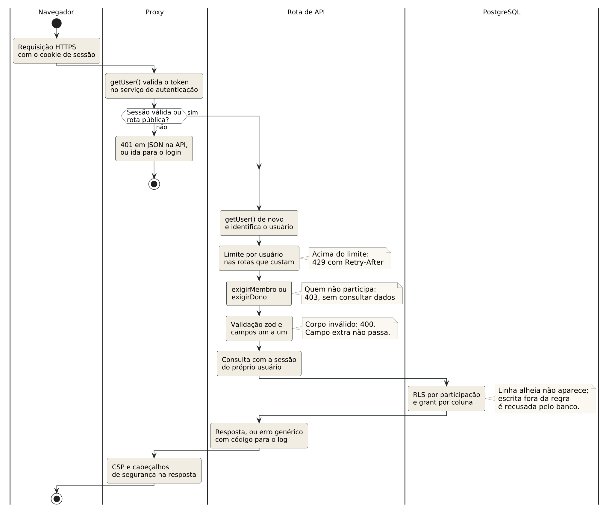

## 25 Segurança da Informação

O Viaja Mais guarda dados de identificação (nome, nome de usuário, foto e e-mail), roteiros com datas e destinos, despesas de grupo e uma rede social com perfis privados. O risco principal não é a indisponibilidade, e sim o acesso indevido: uma pessoa alcançar a viagem, as dívidas ou as publicações privadas de outra.

A postura adotada é a defesa em duas camadas. A rota de servidor verifica explicitamente quem pode fazer o quê, e o banco repete a regra com Row Level Security (RLS, política de acesso por linha do PostgreSQL). As duas são escritas separadamente, de modo que uma falha em uma delas não resulte sozinha em vazamento.

### 25.1 Ativos e modelo de ameaças

| Ativo | Quem não pode acessar | Ameaça principal |
|---|---|---|
| Viagem, itinerário, reservas e lugares | Quem não é membro da viagem | Ler ou alterar a viagem alheia conhecendo o identificador |
| Composição do grupo e convites | Quem não foi convidado | Entrar numa viagem sem convite; tomar posse da viagem |
| Despesas, partes do rateio e pagamentos | Não membros; membros fora da regra de autor ou dono | Alterar a dívida de outra pessoa; marcar a própria parte como paga |
| Conta e sessão | Qualquer terceiro | Adivinhar a senha; usar sessão roubada |
| Perfil privado, rede, publicações e marcações | Quem não é seguidor aprovado | Ver publicações privadas; marcar uma pessoa sem vínculo com ela |
| Fotos de perfil e de publicações | Quem não pode ver o perfil ou a publicação | Link permanente; arquivo malicioso; localização nos metadados |
| Histórico de pesquisa | Todos, exceto o dono | Ler quem uma pessoa procurou |
| Chave de serviço do banco | O navegador e qualquer usuário | Vazar a chave que ignora toda a RLS |

Consideramos quatro atacantes, do mais externo ao mais interno:

- **Visitante sem sessão**, que conhece os endereços da aplicação e da API do banco.
- **Usuário autenticado que não é membro**, que chama a API e o banco diretamente, sem passar pela interface.
- **Membro que tenta agir como dono ou como autor**, por exemplo para remover pessoas ou alterar despesa alheia.
- **Seguidor não aprovado ou estranho**, que tenta ver ou marcar um perfil privado.

Ficam fora do modelo quem tem acesso ao painel do provedor ou às credenciais da equipe, e ataques à infraestrutura da Vercel e do Supabase.

### 25.2 Autenticação e sessão

A autenticação é feita pelo serviço gerenciado do Supabase (Auth), que guarda as senhas com função de resumo própria e nunca as entrega à aplicação.

- **Regra de senha.** Mínimo de 8 caracteres, com letra minúscula, maiúscula, número e símbolo. A regra vale no Auth de produção (conferido no painel em 13/11/2026), no ambiente local e na tela (`lib/seguranca/senha.ts`). O teste `14-politica-senha` prova que o Auth recusa a senha fraca enviada direto pela API.
- **Confirmação de e-mail.** Ligada em produção: ninguém usa a conta antes de confirmar o endereço. No ambiente local ela é desligada de propósito, para desenvolver sem e-mail.
- **Sessão.** A cada requisição, o `proxy.ts` chama `getUser()`, que valida o token no servidor de autenticação em vez de apenas decodificar o cookie. O acesso segue uma lista de permissão: fora da raiz e de `/auth`, tudo exige sessão. A API responde 401 em JSON; as páginas levam ao login.
- **Troca de senha.** A rota confere a senha atual e permite 5 conferências a cada 15 minutos por usuário, para que uma sessão roubada não sirva para descobrir a senha.
- **Recuperação.** Por link enviado ao e-mail. A tela de nova senha continua acessível com a sessão criada pelo link.

Os limites de tentativa de login e de cadastro são os do próprio Auth, por endereço IP. Em produção eles são configurados no painel do provedor e não estão no repositório.

### 25.3 Controle de acesso

O controle é feito duas vezes, e o padrão é o mesmo em toda rota (Figura 25.1).

Cada raia é um ponto onde a requisição pode ser recusada. O proxy barra quem não tem sessão. A rota identifica o usuário, aplica o limite de requisições onde há custo, confere a participação na viagem com `exigirMembro` ou `exigirDono` (`lib/authz/trip.ts`) e valida o corpo. Só então consulta o banco, com a sessão do próprio usuário, e a RLS decide de novo quais linhas ele alcança.

As notas à direita mostram a resposta de cada recusa. A ordem não é arbitrária: autorização antes da validação faz com que quem não participa receba 403 sem saber se o corpo estava certo. Escolhemos 403, e não 404, para a viagem alheia, porque distinguir os dois casos exigiria uma consulta que revelaria se a viagem existe.

No banco, as 18 tabelas têm RLS ligada e ao menos uma política. Isso é conferido a cada execução da suíte de banco pelo teste `00-estrutura`, que falha se uma tabela nova nascer sem RLS ou sem política. As funções de participação usadas pelas políticas respondem apenas sobre o usuário da sessão e não podem ser executadas por visitante (`06-plataforma-convite`).

| Tabela ou recurso | Regra de acesso | Onde é imposta | Teste que prova |
|---|---|---|---|
| `trips` | Membro lê; só o dono edita e exclui; ninguém troca o dono | Rota e RLS, com grant por coluna | `01-isolamento`, `13-participante` (H1) |
| `trip_members` | Entra quem aceita convite para o próprio e-mail; ninguém edita a linha | Rota e RLS | `06-plataforma-convite`, `13-participante` (H4) |
| `trip_invitations` | Só o dono convida; o convidado altera apenas a situação | Rota e grant por coluna | `invitations-post`, `13-participante` (H2) |
| `itinerary_items`, `bookings`, `places` | Qualquer membro, sem trocar autor nem viagem | Rota e RLS | `03-escopo-grupo`, `13-participante` (H3) |
| `expenses`, `expense_shares` | Membro lê; autor ou dono altera; parte só de membro | Rota e RLS | `02-rateio`, `13-participante` (H3, H5) |
| `settlements` | Membro lê; recebedor é membro; registro imutável | RLS | `07-settlements` |
| `place_reviews` | Autenticado lê; avalia quem salvou o lugar numa viagem sua; autor edita | Rota e RLS | `07-avaliacoes` e mutação |
| `profiles` | Autenticado lê os dados básicos; cada um altera o próprio, nas colunas previstas | RLS e grant por coluna | `04-social`, `11-exigir-username` |
| `follows` | Estado inicial decidido pelo banco; o dono do perfil resolve as solicitações | RLS e trigger | `04-social`, `09-solicitacoes`, `10-listas` |
| `posts` | Lê quem pode ver a rede do autor | RLS | `12-trip-posts` |
| `post_tags`, `post_tag_recusas` | Só a autora marca; perfil privado só por quem tem vínculo; recusa vale para sempre | RLS e função do banco | `17-post-tags` |
| `search_history` | Só o próprio usuário | RLS | `08-historico-pesquisa` |
| `rate_limits` | Ninguém, apenas a função de contagem | RLS que nega tudo e grant revogado | `12-rate-limit` |
| Buckets `avatars` e `capas-posts` | Nenhum usuário lê ou grava; só a rota, por link temporário | Storage sem política e rota | `05-avatares`, `12-trip-posts` |

A suíte de isolamento usa usuários reais do seed, autenticados pelo Auth local, e prova as duas direções: o que o usuário pode fazer e o que não pode. São 475 testes. Para as políticas mais sensíveis, aplicamos ainda o teste de mutação (seção 24.1): a política é sabotada no banco local e algum teste precisa falhar.

A chave de serviço do Supabase ignora toda a RLS. Só o módulo `lib/supabase/admin.ts` a lê, e ele lança erro se for executado no navegador. Ela é usada em 16 rotas de servidor e num módulo auxiliar delas, sempre depois de a rota decidir que o usuário pode agir, e apenas para três coisas:

- enviar o convite pela API administrativa do Auth;
- gravar, apagar e assinar links temporários nos buckets privados de fotos;
- manter a fila interna de fotos a remover (`fotos_a_remover`).

Toda leitura e escrita de dados da aplicação usa a sessão do usuário, com a RLS valendo.

### 25.4 Proteção de dados e da aplicação

**Validação de entrada e fim da atribuição em massa.** Todo corpo de requisição passa por um dos 15 esquemas zod de `lib/schemas/`, e a rota grava os campos extraídos um a um do resultado. Um campo extra, como o identificador do dono, não chega ao banco. No banco, o grant por coluna repete a proteção. Nenhuma escrita parte do navegador: toda alteração passa por rota de API.

**Mensagens de erro.** Falha inesperada vira 500 com mensagem genérica, e o detalhe vai para o log com um código também enviado no cabeçalho `X-Codigo-Erro`. Assim o usuário pode relatar o problema sem receber nome de coluna ou de restrição do banco.

**Limite de requisições.** O contador fica no PostgreSQL, na tabela `rate_limits`, porque na Vercel cada requisição pode cair numa instância diferente. A função `consumir_limite` conta de forma atômica e sempre para o usuário da sessão. O limite é por usuário, e não por IP, para que uma rede inteira, como a da faculdade, não seja bloqueada por uma pessoa.

| Regra | Limite | Rotas |
|---|---|---|
| Convite | 10 a cada 10 min | Convite por e-mail |
| Troca de senha | 5 a cada 15 min | Troca de senha |
| Envio de foto | 10 a cada 10 min | Foto de perfil, publicação e fotos da publicação |
| Seguir | 30 por minuto | Seguir perfil |

**Cabeçalhos de segurança.** O `next.config.mjs` envia cinco cabeçalhos em toda resposta, e o `proxy.ts` acrescenta a Content-Security-Policy (CSP, política que diz ao navegador de onde pode carregar recursos).

| Cabeçalho | Valor | Efeito |
|---|---|---|
| `Strict-Transport-Security` | `max-age=63072000; includeSubDomains; preload` | Obriga HTTPS por dois anos |
| `X-Frame-Options` | `DENY` | Impede embutir a aplicação em outro site |
| `X-Content-Type-Options` | `nosniff` | Impede o navegador de adivinhar o tipo do arquivo |
| `Referrer-Policy` | `strict-origin-when-cross-origin` | Não envia o caminho completo a outros sites |
| `Permissions-Policy` | `camera=(), microphone=(), geolocation=()` | Desliga câmera, microfone e localização |
| `Content-Security-Policy` | `script-src 'self' 'unsafe-inline'` e Google Maps; `connect-src` só para a própria origem, o Supabase e o Google; `object-src 'none'`; `frame-ancestors 'none'`; `form-action 'self'` | Limita de onde vem script e para onde vão dados |

A CSP é testada por unidade (`tests/lib/csp.test.ts`) e no build de produção (`e2e/csp.spec.ts`), que confere o cabeçalho e navega pelas telas principais sem nenhuma violação registrada no console.

**Fotos.** Os dois buckets são privados. O navegador recebe um link assinado que vale 10 minutos, com cabeçalho que proíbe cache compartilhado. A rota aceita até 2 MB, confere o tipo pelos primeiros bytes do arquivo, e não pelo nome, e regera a imagem com a biblioteca sharp: o que vai ao bucket é um WebP novo, sem metadados, de modo que a localização GPS da foto original não é guardada.

**Variáveis de ambiente.** São lidas só por `lib/env.ts`, que as valida com zod na inicialização e nomeia a variável ausente. As de servidor lançam erro se forem lidas no navegador. A única chave pública por necessidade é a do Google Maps, cuja proteção depende de restrições configuradas no painel do Google, fora do repositório.

**Perfis privados e marcações.** Publicações seguem a visibilidade do perfil do autor. Desde 22/11/2026, um perfil privado só pode ser marcado por quem ele segue ou por colega da mesma viagem, e a marcação só aparece a quem pode ver a rede dessa pessoa. A recusa de uma marcação vale para aquela autora em qualquer publicação futura.

**Dados pessoais.** Coletamos nome, nome de usuário, biografia, foto, e-mail (guardado só no Auth, nunca copiado para o perfil), os e-mails de convidados, os dados das viagens e o histórico de pesquisa, limitado a 15 entradas e 30 dias. Do ponto de vista da Lei Geral de Proteção de Dados, há três lacunas:

- **Exclusão de conta.** Não implementada (RF02.4). O banco já apaga perfil, vínculos e histórico em cascata quando a conta é removida, o que é testado; falta a tela e a rota.
- **Política de privacidade.** A aplicação não apresenta uma ao usuário.
- **Dados básicos de perfil privado.** Nome, nome de usuário e foto continuam visíveis a qualquer usuário autenticado, por decisão de produto registrada no RF02.

### 25.5 Riscos identificados e medidas

Probabilidade e impacto são estimativas qualitativas da equipe. A situação é **mitigado** (medida implementada e testada), **parcial** (medida com lacuna conhecida), **aceito** (risco conhecido, mantido por decisão justificada) ou **em aberto** (sem medida).

| ID | Risco (categoria OWASP Top 10) | Prob. | Impacto | Medida adotada | Evidência | Situação |
|---|---|---|---|---|---|---|
| R01 | Autenticado lê ou altera viagem alheia (A01) | Média | Alto | `exigirMembro` e RLS por participação | `01-isolamento`, `03-escopo-grupo` | Mitigado |
| R02 | Membro vira dono ou entra sem convite (A01) | Média | Alto | Políticas herdadas removidas; grant por coluna | `13-participante`: 17 de 30 casos falhavam antes, 30 de 30 depois | Mitigado |
| R03 | Membro altera despesa ou parte alheia (A01) | Média | Alto | Só autor ou dono escreve; parte só de membro | `13-participante`, `02-rateio` | Parcial |
| R04 | Funções do banco revelam participação de terceiros (A01) | Baixa | Médio | Respondem só sobre a sessão; visitante sem execução | `06-plataforma-convite`, `04-social` | Mitigado |
| R05 | Perfil privado exposto por publicação ou marcação (A01) | Média | Médio | Visibilidade pela rede; marcação exige vínculo | `12-trip-posts`, `17-post-tags` | Mitigado |
| R06 | Uso indevido da chave de serviço (A01) | Baixa | Alto | Um módulo, só no servidor, três usos | `tests/lib/supabase-admin.test.ts` | Parcial |
| R07 | Tráfego interceptado ou rebaixado a HTTP (A02) | Baixa | Alto | HTTPS, HSTS e promoção de requisições inseguras | `next.config.mjs`, `csp.test` | Mitigado |
| R08 | Link de foto vira acesso permanente (A02) | Média | Médio | Bucket privado, link de 10 min, sem cache | `05-avatares` e mutação | Mitigado |
| R09 | Injeção de SQL (A03) | Baixa | Alto | Toda consulta pelo cliente do Supabase, parametrizada; nenhum SQL montado por texto na aplicação | Código de `app/` e `lib/` | Mitigado, sem teste específico |
| R10 | Script injetado na página (A03) | Média | Alto | Escape automático do React; CSP fecha origens e saída de dados | `csp.test`, `e2e/csp.spec.ts` | Parcial |
| R11 | Atribuição em massa (A04) | Média | Alto | Zod e campos um a um; grant por coluna | `trips-post`: campo extra não grava | Mitigado |
| R12 | Abuso de rotas com custo (A04) | Média | Médio | Limite por usuário no banco | `12-rate-limit`, testes de 429 | Parcial |
| R13 | Arquivo malicioso como foto (A04) | Média | Médio | 2 MB, tipo pelos bytes, imagem regerada | `social-perfil-foto-route`, `imagem.test` | Mitigado |
| R14 | Página embutida em outro site (A05) | Baixa | Médio | `X-Frame-Options` e `frame-ancestors` | `csp.test` | Mitigado |
| R15 | Mensagem interna do banco exposta (A05) | Média | Baixo | Erro genérico com código de log | `trips-post`, `change-password-route` | Parcial |
| R16 | Segredo no navegador ou variável ausente (A05) | Baixa | Alto | `lib/env.ts` com validação e bloqueio no navegador | `env.test` | Mitigado |
| R17 | Dependência com vulnerabilidade conhecida (A06) | Média | Médio | Instalação pelo lockfile; versão fixa da ferramenta do banco | — | Em aberto |
| R18 | Senha fraca ou força bruta (A07) | Média | Alto | Regra de 8 caracteres com quatro classes; limite na troca | `14-politica-senha`, `senha.test` | Parcial |
| R19 | Conta com e-mail alheio recebe convites (A07) | Baixa | Médio | Confirmação de e-mail em produção | Painel, conferido em 13/11 | Mitigado, sem teste automatizado |
| R20 | Banco de produção diverge do repositório (A08) | Média | Alto | Migrations do zero na esteira | `db.yml`, `00-estrutura` | Parcial |
| R21 | Incidente sem registro rastreável (A09) | Média | Médio | Código de erro no log e na resposta | `lib/http.ts` | Parcial |
| R22 | Titular não consegue eliminar os próprios dados (LGPD) | Alta | Médio | Cascata no banco | `04-social`, exclusão de conta | Em aberto |
| R23 | Convidado se inclui na viagem com papel de dono (A01) | Baixa | Médio | Política de inclusão só aceita o papel de membro | `06-plataforma-convite` | Mitigado |
| R24 | Instrução maliciosa no pedido à IA ou resposta fora do formato (LLM01) | Média | Baixo | Pedido enviado como dado; resposta validada por esquema e revisada pela pessoa antes de gravar | `ai-gemini.test`, `ai-roteiro.test`, `roteiro-ia.spec` | Mitigado |

O que falta em cada risco parcial:

- **R03.** O autor de uma despesa ainda escolhe quem deve e pode mover uma parte entre despesas suas. É regra do produto, e a defesa é social: a despesa aparece para todo o grupo.
- **R06.** O comentário de `lib/supabase/admin.ts` diz que a chave serve só ao Auth administrativo, mas ela é usada também no Storage e na fila de fotos. A regra é cumprida pela revisão de cada rota, sem teste que impeça um uso novo.
- **R10.** A CSP admite `'unsafe-inline'` em `script-src`. A alternativa, CSP com nonce, obrigaria todas as páginas a renderizar dinamicamente; o risco de quebrar telas a poucos dias da entrega foi maior que o ganho.
- **R12.** O limitador libera a requisição se a contagem falhar, por decisão: ele não pode ser o motivo de um convite legítimo falhar. A janela é fixa, e permite até o dobro do limite na virada. A função aceita a janela informada por quem chama, e quem a chama direto pela API com outra janela zera o próprio contador (achado da revisão de 20/11, reproduzido no banco local); a correção, que fixa a janela de cada regra no banco, está planejada.
- **R15.** Quando a própria consulta de participação falha, `papelNaViagem` devolve a mensagem do banco num 500, sem passar pela mensagem genérica.
- **R18.** O limite de tentativas de login em produção é o do provedor, configurado fora do repositório. O envio de e-mail usa o servidor padrão do Supabase, com cota baixa por hora.
- **R20.** As migrations são aplicadas manualmente em produção. Nada prova automaticamente que o banco publicado está igual ao do repositório.
- **R21.** Os erros são registrados com `console.error`, sem estrutura (RNF05.5 planejado).

O R23 foi encontrado na revisão feita para esta seção, pela leitura das migrations. A política de inclusão em `trip_members` exigia convite pendente para o e-mail da sessão, mas não restringia o papel informado. Um teste com dois usuários confirmou a falha: o convidado se incluía como dono, e a rota, que lê o papel nessa tabela, passaria a aceitá-lo como dono.

Corrigimos a falha na migration `20261122160000_plataforma_convidado_entra_como_membro.sql`: a política passou a aceitar apenas o papel de membro, e o teste de regressão, que falhava antes, passa depois. A linha do dono é gravada por gatilho na criação da viagem e não depende dessa política.

O efeito era parcialmente contido pela segunda camada: no banco, dono é quem criou a viagem (`trips.user_id`), e as políticas de dono usam essa fonte. O achado mostra uma inconsistência que permanece: o sistema tem duas fontes para "dono", e as duas camadas consultam fontes diferentes.

Parte dos riscos foi registrada como vulnerabilidade potencial na entrega de 18/10/2026. Três das quatro hipóteses daquela versão (participante virar dono, convite redirecionado para outra viagem e despesa alheia alterada) foram confirmadas por teste e corrigidas em 12/11 (R02 e R03). A quarta, convidado entrar como dono, foi confirmada e corrigida em 22/11/2026 (R23). O risco de foto não reprocessada foi eliminado (R13), e a CSP e o limite de requisições, então planejados, foram implementados.

### 25.6 Riscos residuais e próximos passos

O que continua em aberto, em ordem de prioridade:

1. **Fonte única para o papel de dono.** Fazer `exigirDono` consultar a mesma fonte que o banco (`trips.user_id`), para que a falha corrigida em R23 não reapareça por outro caminho.
2. **Direitos do titular.** Implementar a exclusão de conta (RF02.4) e publicar uma política de privacidade antes de receber usuários reais em escala.
3. **Migrations em produção.** Automatizar a aplicação a partir da `main`, ou ao menos comparar o schema publicado com o do repositório na esteira.
4. **Auditoria de dependências.** Nenhum dos workflows audita dependências, e `@supabase/ssr` está declarado como `latest` no `package.json`. Os próximos passos são fixar a versão e incluir a auditoria na esteira.
5. **CSP com nonce.** Retirar `'unsafe-inline'` dos scripts, aceitando a renderização dinâmica das páginas.
6. **Teste de intrusão externo.** Toda a análise desta seção foi feita pela própria equipe. Nenhuma pessoa de fora tentou atacar a aplicação.
7. **Registro estruturado de erros**, com rota, usuário e causa, para que um incidente possa ser reconstruído.

Uma decisão sustenta a postura de segurança mais do que qualquer medida isolada: tratar como não verificada toda afirmação sem evidência no repositório. A documentação herdada afirmava RLS em todas as tabelas sem nenhuma política versionada, e foi essa desconfiança que levou às falhas corrigidas na Fase 01, na revisão da camada social e na revisão de participantes de novembro.
